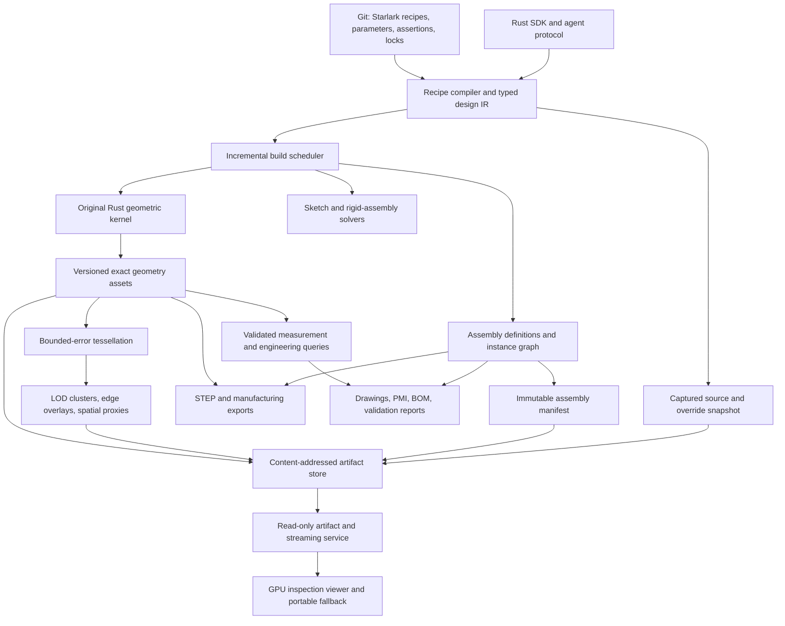

# Target architecture: commercial-scale, AI-native headless CAD

Status: target design, with an implementation baseline and release gates below.
Updated: 2026-10-11. The project goal is active.

## Product goal

Build an **Apache-2.0-licensed, headless, AI-native CAD system with our own Rust
kernel**, targeting the engineering workflows served by commercial platforms
such as Autodesk Inventor and Fusion. The first market is mechanical parts,
assemblies, and manufacturing deliverables. Matching every Autodesk product is
not a single release criterion.

Engineering reliability, large-assembly performance, automation, reproducibility,
and manufacturing interoperability are the competitive measures. The current
rectangular-solid implementation is an executable starting point. Its limits do
not define the target product. Feature development must expand the example and
regression corpus toward increasingly demanding real engineering work.

First-party kernel, recipe compiler, headless services, interchange, and viewer
are Apache-2.0. Third-party components retain their own licenses and notices;
release inventories must cover dependencies and redistributed assets. Essential
modeling and automation must work offline without proprietary kernel licenses,
paid AI services, or a vendor-hosted account.

## Architectural commitments

1. **Code and recipes are authoritative.** Git stores source, parameters,
   dependency locks, design assertions, drawings' intent, and assembly intent.
   Geometry and display assets are rebuildable products.
2. **Our kernel owns geometry.** Supporting math, spatial, serialization, and
   graphics libraries are welcome. OCCT is currently an independent test oracle,
   not the implementation behind a Rust facade.
3. **The viewer is an inspection client.** Camera movement, picking, filtering,
   sections, source browsing, and display-asset fetching do not mutate designs.
   Modeling jobs originate from recipes through the headless CLI/API. Exact
   engineering results are produced by headless queries and may be displayed by
   the viewer; a visual approximation is never silently presented as exact.
4. **Separate design identity, geometric state, and display state.** A logical
   component or feature can keep its identity while its content changes.
   Array offsets, tessellation triangles, and cache keys are not design IDs.
5. **Load the representation a task needs.** Opening an assembly for inspection
   must not deserialize every exact solid. Repeated components share geometry
   and display assets.
6. **A failed operation does not publish invalid geometry.** Preserve the last
   complete valid generation, return structured diagnostics, and expose repair
   decisions. Never silently change dimensions to make a test pass.
7. **Tests are release evidence, not a proof over all geometry.** Combine precise
   contracts, robust algorithms, independent invariants, adversarial corpora,
   differential checks, and explicit unsupported/ambiguous outcomes.

### Competitive requirements and evidence

The supplied feature ideas become the following engineering requirements. Each
requires its own acceptance evidence; a successful viewer demo cannot close a
kernel, solver, or manufacturing milestone.

| Requirement | Architectural owner | Required evidence |
| --- | --- | --- |
| Large assemblies without loading all exact geometry | Assembly manifests, artifact service, residency manager | Overview loads zero exact bodies; benchmark repeated and unique parts separately under enforced memory budgets |
| Reliable edits through long feature histories | Semantic references, operation lineage, incremental builder | Topology-changing edit sequences preserve intent or report deletion/ambiguity; no silent retargeting |
| Robust modeling and controlled recovery | Original Rust kernel and explicit repair policy | Independent geometric invariants, adversarial cases, bounded repair deviations, retained last valid generation |
| Sketches and mechanisms with useful diagnostics | Separate sketch and rigid-frame constraint services | Residuals, degrees of freedom, conflicting constraints, singularities, and edit-continuation tests |
| Progressive inspection of detailed models | Meshing workers, display hierarchy, GPU viewer | Measured screen-space error, bounded residency, correct identity through refinement, usable coarse fallback during loading |
| Manufacturing and team workflows | Engineering queries, drawings/BOM, revision and exchange services | Associative deliverables, revision traceability, configuration-aware quantities, independently checked open exports |
| AI-native, source-driven automation | Typed recipe IR, capability protocol, isolated build jobs | Reviewable source patches, reproducible snapshots, structured failures, deterministic publication, no viewer mutation dependency |

These requirements govern the roadmap and example progression. Performance
targets below are proposed release gates, not results inferred from the notes.

## System decomposition

These are logical boundaries, not instructions to create empty crates or deploy
microservices immediately. Start as versioned Rust interfaces and local workers;
introduce process or network boundaries where isolation, parallel execution, or
artifact distribution justifies them. No kernel dependency on a browser, GPU,
window system, network, or language-model provider is permitted.

### Three distinct graphs

| Graph | Nodes and edges | Responsibility |
| --- | --- | --- |
| Feature/build DAG | Typed operations, inputs, source spans, assertions | Incremental deterministic evaluation and failure provenance |
| Topology and lineage | Vertices, oriented edge uses, loops, faces, shells, solids; generated/modified/split/merged/deleted relations | Solid correctness and persistent semantic references |
| Assembly instance graph | Part definitions, nested instances, rigid transforms, joints, configurations | Reuse, placement, BOM, motion, and selective loading |

The geometric topology is not necessarily a DAG: boundary loops and incidence
are inherently cyclic. Constraints also form graphs with loops. An assembly is
not a Boolean union of its parts. Fixtures and enclosures use explicit part
instances; the modular rack reuses nested rows and carriages. Older examples can
still use disjoint unions. Joints and datums remain target work.

## Authoring and AI-native execution

Keep **Starlark as the initial authoring language**, with a typed, versioned IR as
the stable boundary and a native Rust SDK for library consumers. JSON is the
resolved interchange/debug form. YAML need not become a second programming
language. Reconsider a custom language only when concrete domain ergonomics
justify its parser, tooling, migration, and compatibility costs.

Evolve today's recipe frontend toward modules resolved from a checked lockfile,
dimension-aware values, named coordinate systems, declarative sketches, reusable
part definitions, patterns, instances, configurations, materials, and assertions.
External assets use explicit content references; evaluation does not fetch
unlocked dependencies or read ambient time, environment, or arbitrary files.

An agent works through the same public operation schemas and build protocol as a
human-authored recipe. Provide machine-readable capabilities, input ranges,
source locations, dependency explanations, cancellation, progress events, and
structured failure witnesses. The agent's proposed source patch is reviewable;
once accepted, evaluation is independent of which model proposed it. Persist
source and overrides with every published generation, not a generated geometric
approximation of the original recipe.

The future job API has explicit snapshot/expected-version inputs and idempotent
request keys. A worker reads one immutable source snapshot, returns artifacts and
validation, and publishes only a complete generation. Untrusted hosted recipes
run in isolated processes with CPU, memory, filesystem, and network limits; the
current Starlark interpreter limits alone are not this service boundary.

## Original Rust kernel

### Geometry and numerical policy

Separate geometric primitives/evaluators from oriented topology and modeling
operations. Extend supporting lines and planes to circles, ellipses, analytic
surfaces, B-splines/NURBS, trimmed curves/surfaces, periodic seams, singularities,
and per-edge parameter-space curves. A 3D edge shared by two faces can have a
different parameter-space curve on each face.

“Exact geometry” here means the authoritative analytic/trimmed representation,
with declared numerical error and tolerance. It does not mean arbitrary CAD
intersections have symbolic or infinitely precise coordinates. Meshes and voxel
fields are derived representations with separately recorded error bounds.

Use robust orientation/incidence predicates, scaled numerical conditioning,
interval or adaptive-precision fallbacks where justified, and explicit error
budgets for intersections, projections, and trimming. Tolerances distinguish
model units, geometric uncertainty, solver residuals, and display error. Imported
local tolerances need provenance and permitted ceilings; a single global epsilon
cannot replace that policy.

### Modeling operations and repair

The general Boolean pipeline needs broad-phase candidate filtering, geometric
intersection, parameter-space splitting, consistent coincidence classification,
region selection, sewing/reconstruction, history propagation, and validation.
The current coordinate arrangement remains useful for the supported orthogonal
subset and as a test oracle; it is not the general curved-solid algorithm.

Progress through rigid transforms, planar profiles with holes, curved extrusion,
revolution, generalized Booleans, sweeps/lofts, chamfers/fillets, offsets/shelling,
and controlled import repair. Include open shells and cavity orientation in the
data model before promising shelling. Each operation declares supported input
classes, degeneracies, maximum work, postconditions, and meaningful failures.

Healing is an explicit policy-driven operation: record changed entities, maximum
deviation, tolerance changes, and removed or merged features. Preserve an
unmodified imported source. A near-coincident repair must not erase intentional
clearance without a diagnostic and a policy that authorizes the deviation.

### Persistent topology references

Use three explicit identity types: snapshot-local entity handles, persistent
semantic entity references, and assembly instance paths. A downstream recipe
references a semantic role or selector plus feature lineage, not `Face14`. Track operation-generated roles and many-to-many history:
unchanged, generated, split, merged, deleted, and unresolved. Cache reuse must
preserve instance-local provenance even when geometry is deduplicated.

Selectors combine semantic roles, named datums, ownership, adjacency, geometric
predicates, and expected cardinality. On regeneration they resolve to exactly the
required entities or return an ambiguity/deletion diagnostic with candidates.
Do not claim that a UUID alone solves topology changes or silently choose the
nearest face after a split. Store selector intent with source, and persist the
resolved witness in build reports for review and regression tests.

The current `cad select` query implements the first scoped contract: anchor a
generated face role to a logical feature, follow explicit orthogonal Boolean and
translation lineage to a target feature, and require one, N, or all nonempty
descendants. Reports distinguish resolved, deleted, ambiguous, and unsupported,
with snapshot fingerprints and face/operation witnesses. This is recomputed from
source intent on each build; it is not persistent numbering. General geometric
predicates, edge/vertex selectors, datums, instance paths, and consumption by
downstream modeling operations remain work to implement.

Starlark `assert_faces` persists this selector intent in schema-2 recipes. The
build resolves each assertion before artifact publication, including on cached
geometry; manifests retain successful witnesses and semantic diffs expose
assertion changes. This is the first build-time consumer of semantic references.
It does not yet attach a sketch or drive a geometric operation from a reference.

## Constraints and assemblies

Build a constraint service separately from geometric construction. The 2D sketch
solver reports degrees of freedom, residuals, conflicting constraints, multiple
solution branches, and convergence limits. Preserve branch/continuation intent
across small parameter edits; diagnose underconstrained sketches explicitly.

The assembly solver operates on rigid frames, named attachment datums, joint
parameters, and sparse constraints. It must not need full solid data to solve
ordinary placement. Partition independent constraint islands, fix gauge freedoms,
use deterministic ordering and bounded nonlinear solving, and report residuals
and unresolved degrees of freedom. Collision and clearance queries are separate
from kinematic constraint satisfaction.

A part definition references immutable geometry and display assets. An instance
has its own persistent identity, definition/version reference, rigid transform,
configuration, suppression state, material/metadata overrides, and parent path.
Repeated fasteners share one asset. Nested assemblies need cycle detection,
transform composition, instance-aware picking, and distinct BOM quantity rules.

Load bounds, transforms, coarse graphics, names, and required datums first.
Request exact bodies only for affected modeling, certified queries, precise
sections/drawings, or export. Track independent budgets and eviction for exact
bodies, CPU display assets, GPU residency, and queued work. A many-part assembly
must be useful with zero resident exact B-reps during graphics-only inspection.

## Display assets, streaming, and GPU responsibilities

### Independent display build

Derive meshes in a separate worker. A display cache key includes geometric
content, mesher implementation, chordal/angular error, edge policy, coordinate
quantization, and display-format version. Preserve shared boundaries, normals,
sharp feature edges, and triangle-to-semantic-face mappings during tessellation.
Record measured or conservative error bounds; do not assume a simplifier's
heuristic score is automatically a certified distance bound.

First implement cached meshes, instancing, frustum culling, coarse part LODs, and
explicit residency budgets. Then add bounded clusters/meshlets, hierarchy
construction, crack-safe transitions, compression, spatial indexing, and
screen-space-error refinement. Use measurements to select cluster sizes rather
than hard-coding a universal 64–128-triangle rule.

Do not merge away part identity, topology labels, sharp boundaries, or thin
engineering features merely to reduce draw calls. Selected entities, dimensions,
and critical edges require refinement or a separate precise overlay. A coarse
cluster can represent several faces: coarse picking returns an instance/region
candidate and refines before claiming a particular semantic face.

### Streaming and cache contract

An immutable assembly manifest references versioned part manifests and display
pages. Serve content-addressed blobs with range-capable HTTP where useful;
transport is replaceable and does not require WebSockets. Small generation
notifications can be separate from bulk geometry transfer. Prioritize visible
coarse coverage before refinement, cancel obsolete requests, apply backpressure,
and keep parent LODs resident until complete replacements arrive.

Each response and displayed generation carries its own identity. Never combine
new metadata with old geometry or accept an A→B→A interleaving as a consistent
snapshot. Missing assets produce a visible loading/proxy state; they do not mean
empty geometry. Cache eviction must not discard the only visible fallback.

### GPU and portability

Target a Rust graphics backend such as `wgpu` with browser WebGPU and native
backends, subject to a supported-device matrix. Baseline rendering must not
require mesh shaders: indexed instanced rendering plus optional compute culling
can support the first scalable implementation. Add mesh-shader or other advanced
paths only behind runtime feature checks and measured gains. Keep a lower-capacity
fallback for unsupported devices; the current Canvas viewer is that prototype,
not the planned large-assembly renderer.

GPUs are natural for visibility, rasterization, display refinement, batch spatial
candidates, and some tessellation work. They do not automatically solve robust
trimmed-surface intersections, topology reconstruction, or persistent naming.
Use object-local or camera-relative coordinates for GPU display to avoid losing
small features in large world coordinates; keep authoritative coordinates and
unit transforms independently. Authoritative modeling initially uses CPU algorithms with deterministic scheduling
and documented floating-point limits. Evaluate GPU geometry kernels separately
against the same error and validity contracts.

Analytic surface rendering is an optional research path. Trimming, seams,
precision, clipping, picking, and interoperable exported geometry still need
solutions. Neither one-triangle-per-pixel nor infinitely smooth zoom is an
unconditional performance/correctness guarantee for engineering assemblies.

## Queries, drawings, and engineering deliverables

Expose accuracy explicitly: visual approximation, conservative bound, or
validated geometry result with tolerance/error. Bounding boxes can reject
collision candidates; overlapping boxes cannot prove collision. Approximate
LOD meshes cannot certify clearance or machining dimensions. Exact query workers
load only candidate bodies and attach evidence to the result.

Treat manufacturing output as a first-class domain: associated orthographic and
section views, hidden-line removal, dimensions and datums, GD&T/PMI intent,
materials/density, mass properties and inertia, BOM, part/revision numbers, and
configuration-aware quantities. Drawings and annotations have stable design
references and testable revision behavior, not screenshot-only geometry.

Evolve today's planar STEP/STL export toward analytic STEP import/export and
assembly/PMI-capable AP242 subsets, with a published support matrix and round-trip
loss reports. Add useful manufacturing and display formats through adapters;
open-format support must state which entities, units, transforms, and metadata
survive. glTF or mesh packages serve visualization; STL does not preserve CAD
semantics. BOM/PLM/ERP adapters consume versioned identifiers and reports.

## Reproducibility, collaboration, and operations

Keep source in Git and large immutable artifacts in a content-addressed store.
Do not require binary geometry merges. Semantic diffs should explain changed
parameters, resolved selections, topology/geometry, mass, clearances, and BOM.
Git handles textual collaboration; an engineering revision adds a pinned build,
validation results, approval state, and auditable change provenance. Distributed
workers need cancellation, resource quotas, crash recovery, atomic publication,
and bounded concurrency before remote multi-user hosting is offered.

Version operation schemas, kernel semantics, solver policy, meshing policy,
serializer formats, source dependencies, and build toolchains independently.
Reuse unaffected DAG nodes. Native recipe artifacts, imported exact geometry,
display meshes, and engineering reports have different invalidation rules.
Cross-platform byte identity is a tested capability where achieved, not a blanket
promise for all floating-point computations or GPU executions.

## Verification and scale gates

Expected-output tests must include volume/area/bounds and topology, not just
images or equality with the implementation's own calculations. Use independent
analytic constructions, metamorphic identities, randomized/adversarial inputs,
edit/regeneration sequences, differential checks against independent kernels,
and round-trip exports. An oracle disagreement is evidence to investigate;
neither majority vote nor one successful import proves correctness.

Keep property fuzzing, minimization, numerical-policy boundary tests, mutation
validation, cancellation/resource tests, and source/manifest publication races
in the test strategy. Benchmark both cold and warm caches, many repeated parts
and many unique parts, malformed imports, slow networks, and device loss.

Initial **aspirational gates**, not measured product claims:

| Workload | Proposed acceptance gate |
| --- | --- |
| Regeneration correctness | At least 500 committed topology-changing edit sequences with no silent selector retargeting; ambiguities explicit |
| Shared definitions | Editing one definition rebuilds once across all instances; placement-only changes rebuild no geometry |
| 25,000 instances / 1,000 unique parts | Graphics-only opening deserializes zero exact bodies; explicit memory budget enforced |
| Reference assembly first view | Usable coarse scene within 3 seconds on pinned local NVMe benchmark machine |
| Reference assembly interaction | 1080p opaque inspection p95 frame time ≤16.7 ms on pinned supported discrete GPU |
| Display residency | ≤2 GiB CPU display data and ≤1 GiB GPU data in that benchmark, with visible fallback under pressure |
| 100,000-instance stretch scene | Progressive loading and usable navigation with documented degradation; no unlimited memory growth |
| Exact queries and exports | Results independent of viewer LOD, camera, and asset residency |
| Versioned engineering release | Rebuildable source/lockfiles, validation corpus, support matrix, dependency notices, and open exports |

Before a performance gate can pass, check in dataset generation, exact unique/
repeated-part mix, viewport, tessellation/error settings, build revision, CPU/GPU/
driver/OS, storage/network conditions, and timing instrumentation. Display loading
and exact geometry evaluation get separate timings. Adjust budgets through a
reviewed decision based on evidence, not by relabeling missed targets.

## Implemented baseline and remaining work

| Area | Implemented now | Target work |
| --- | --- | --- |
| Authoring | Starlark functions/loops/parameters; strict JSON graph; Rust structs | Locked modules, unit types, source maps, public agent/SDK contracts |
| Kernel | Validated orthogonal B-rep; rectangular extrusion; translation; Booleans | General geometry, robust intersections, cavity/trim handling, richer operations |
| References | Feature-role face selectors, explicit orthogonal face lineage, cardinality diagnostics, recipe assertions and snapshot witnesses | Datums, instance paths, edge/vertex and predicate selectors, downstream reference consumers, general-geometry history |
| Assemblies | Schema-2 reusable definitions, nested rigid instances, explicit paths, shared assets and hierarchical STEP | Datums, constraints, configurations, BOM |
| Builds | Local DAG/cache, captured source, atomic artifact generations, watch | Parallel jobs, isolated workers, distributed content store, semantic diffs |
| Viewer | HTTP gallery, depth-buffer Canvas inspection, compact instanced display assets, occurrence picking, recipe panel, live refresh | GPU instancing, lazy assets, bounded LOD streaming, sections/overlays |
| Exchange | Planar AP214 STEP/STL, shared STEP definitions and named occurrences; independent OCCT/XCAF checks | Analytic import/export, AP242 PMI support, broader exchange fidelity and loss reporting |
| Engineering | Volume/bounds, explicit part metadata/density, nested quantity BOM, summed mass and CSV/JSON reports | Sketch/assembly solving, drawings, GD&T, material property libraries, configurations and mass moments |

The milestone dependency order and example progression are in [roadmap.md](roadmap.md).
The current working commands are in [README.md](../README.md).

## Supporting-library evaluation

These are candidates, not newly installed dependencies or substitutes for our
kernel. Pin versions, evaluate numerical/performance behavior on our corpus, and
review transitive licenses before adoption.

| Candidate | Intended boundary | Upstream license and evidence |
| --- | --- | --- |
| nalgebra | Small matrices, transforms, numerical foundations | Apache-2.0; [repository](https://github.com/dimforge/nalgebra) |
| robust | Adaptive orientation/incircle predicates | Apache-2.0 OR MIT; [repository](https://github.com/georust/robust) |
| faer | Dense/sparse linear algebra for solver experiments | MIT; [sparse solver documentation](https://docs.rs/faer/latest/faer/sparse/linalg/solvers/index.html), [license](https://github.com/sarah-quinones/faer-rs/blob/main/LICENSE) |
| Truck components | Evaluate selected math, tessellation, and interchange implementations/reference designs | Apache-2.0; [repository](https://github.com/ricosjp/truck) |
| wgpu | Native/browser graphics and optional compute | Apache-2.0 OR MIT; [repository](https://github.com/gfx-rs/wgpu) |
| meshopt / meshoptimizer | Display clustering, simplification, compression, reordering | Wrapper Apache-2.0 OR MIT; C++ implementation MIT; [wrapper](https://github.com/Traverse-Research/meshopt-rs), [upstream](https://github.com/zeux/meshoptimizer) |

`meshopt` is an FFI wrapper, not an all-Rust implementation. Permissive supporting
FFI can be evaluated without outsourcing the original modeling kernel. Predicate
and linear-algebra libraries do not provide a complete reliable sketch solver,
trimmed-surface intersector, or persistent naming algorithm.

Current wgpu documentation exposes experimental native-only mesh shaders and
backend-limited double-precision support. Neither is the portable browser
baseline. These feature details can change and must be checked against the
selected release and device capabilities. [Mesh-shader feature](https://docs.rs/wgpu/latest/wgpu/struct.Features.html#associatedconstant.EXPERIMENTAL_MESH_SHADER),
[double-precision feature](https://docs.rs/wgpu/latest/wgpu/struct.Features.html#associatedconstant.SHADER_F64).

## Evidence and interpretation of the supplied notes

The supplied notes are architectural input, not benchmark evidence about named
competitors. We adopt lazy loading, persistent design references, separate
assembly solving, and streamed display assets; broad product superiority claims
and unmeasured timing/percentage claims are not requirements.

Autodesk documents a graphics-cache Express mode and loading component data on
demand. That supports the representation separation; it does not establish
universal assembly-size or frame-rate guarantees. [Autodesk Express Mode](https://help.autodesk.com/cloudhelp/2026/ENU/Inventor-Help/files/GUID-34C9AE4C-EDA7-4E46-AD51-3383A67FF1B9.htm).

Epic documents hierarchical triangle clusters, view-dependent detail and demand
streaming, while explicitly retaining practical content/hardware limits. These
are useful display-design principles. We are not adopting Unreal/Nanite code or
claiming that mesh virtualization provides an exact CAD kernel. [Epic Nanite overview](https://dev.epicgames.com/documentation/en-us/unreal-engine/nanite-virtualized-geometry-in-unreal-engine).

OCCT itself provides shape analysis, repair, tolerance handling, and status
reporting. A blanket assumption that it lacks healing is incorrect; robustness
comparisons require a reproducible corpus. [OCCT Shape Healing](https://occt3d.com/dev/doc/overview/html/occt_user_guides__shape_healing.html).
