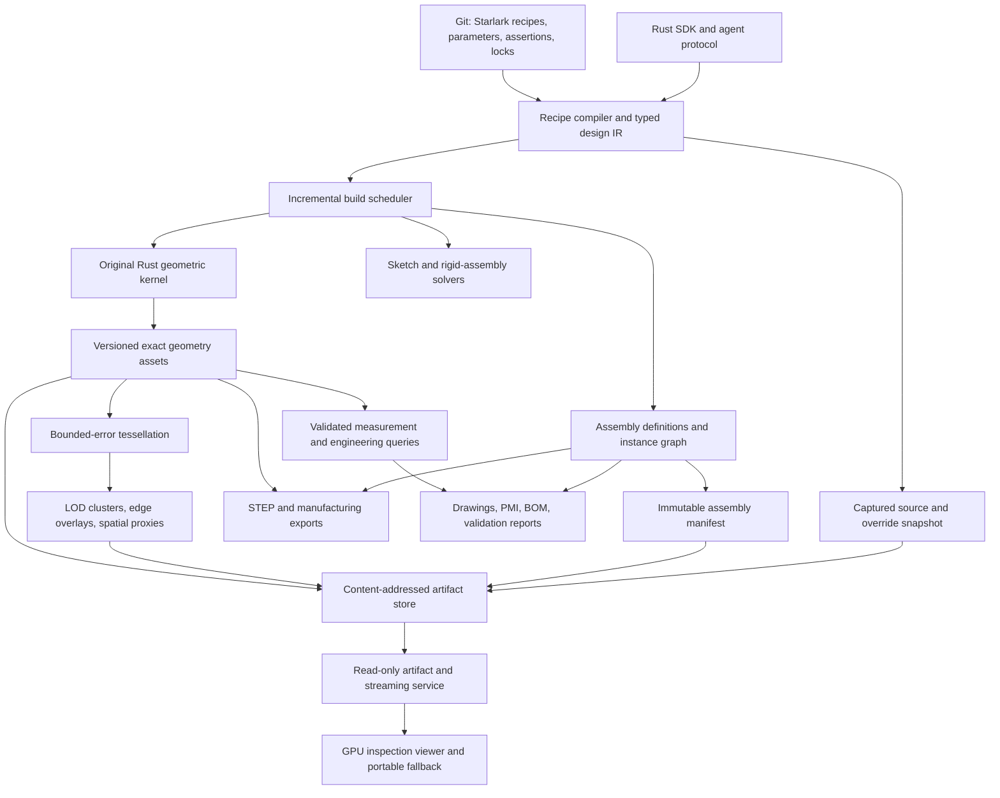

# Target architecture: commercial-scale, AI-native headless CAD

Status: target design, with an implementation baseline and release gates below.
Updated: 2026-10-12. The project goal is active.

## Product goal

Build an **Apache-2.0-licensed, headless, AI-native CAD system with our own Rust
kernel**, targeting the engineering workflows served by commercial platforms
such as Autodesk Inventor and Fusion. The first market is mechanical parts,
assemblies, and manufacturing deliverables. Matching every Autodesk product is
not a single release criterion.

Engineering reliability, large-assembly performance, automation, reproducibility,
and manufacturing interoperability are the competitive measures. The current
orthogonal and planar solids, analytic extrusions, and full-turn piecewise-linear
revolutions are an executable starting point. Their limits do not define the
target product. Feature development must expand the example and
regression corpus toward increasingly demanding real engineering work.

The competitive target is Autodesk-class mechanical engineering, rather than
feature parity with FreeCAD. Success means a team can author, revise, validate,
inspect and release an engineering assembly from source. A fast viewer, a large
test count, or a recipe-to-STL demo alone does not satisfy that goal.

First-party kernel, recipe compiler, headless services, interchange, and viewer
are Apache-2.0. Third-party components retain their own licenses and notices;
release inventories must cover dependencies and redistributed assets. Essential
modeling and automation must work offline without proprietary kernel licenses,
paid AI services, or a vendor-hosted account.

Goal reaffirmed on 2026-10-12 from the commercial-CAD and virtualized-geometry
briefs: this is a product-level engineering ambition, covering the kernel,
regeneration, assemblies, manufacturing and team workflows. The project goal
remains active until a declared commercial workflow passes its release gates;
finishing the current prototype or display milestone does not complete it.

## Architectural commitments

### Decisions adopted from the feature brief

The product target is an engineering team releasing a revised mechanical design
from Git, with an inspectable chain from source intent to manufacturing evidence.
The following decisions govern implementation priorities, not just the viewer:

| Priority | Decision | Completion evidence |
| --- | --- | --- |
| Reliable engineering edits | Develop robust geometry, semantic references and incremental regeneration together | A changed bearing size survives the supported feature history or reports a precise unsupported/ambiguous obligation; no silently repaired dimensions |
| Large designs on bounded hardware | Independently schedule and budget exact bodies, assembly metadata, display assets and query results | Measure cold opening, one-part revision and release generation separately; count loaded bodies and peak memory, not only frames per second |
| Progressive GPU inspection | Build part LODs and paged metadata before a cluster-streaming backend; keep rendering replaceable | The staged M3 gates below pass with retained occurrence/source identity and explicit unresolved detail |
| Mechanical design intent | Solve sketches and rigid-frame mechanisms through headless services | Report residuals, degrees of freedom, conflicts and branch changes; geometry is requested separately for interference checks |
| Manufacturing and collaboration | Release drawings, BOM, validation and open exchange against one immutable revision | A revised release pack is reproducible offline and traceable to reviewed source and configuration |

Treat software architecture and hardware capacity as coupled constraints. Lazy
loading cannot eliminate the cost of building a new unique part, solving a hard
constraint system or exporting an entire detailed assembly. Profile those jobs
independently; faster display must not conceal an unbounded headless build.

### Invariants

1. **Code and recipes are authoritative.** Git stores source, parameters,
   dependency locks, design assertions, drawings' intent, and assembly intent.
   Geometry and display assets are rebuildable products.
2. **Our kernel owns geometry.** Supporting math, spatial, serialization, and
   graphics libraries are welcome. OCCT is currently an independent test oracle,
   not the implementation behind a Rust facade.
3. **The viewer is an inspection client.** Camera movement, picking, filtering,
   sections, source browsing, and display-asset fetching do not mutate designs.
   Modeling jobs originate from recipes through the headless CLI/API. Exact
   engineering results are produced by headless queries and may be displayed by
   the viewer; a visual approximation is never silently presented as exact.
4. **Separate design identity, geometric state, and display state.** A logical
   component or feature can keep its identity while its content changes.
   Array offsets, tessellation triangles, and cache keys are not design IDs.
5. **Load the representation a task needs.** Opening an assembly for inspection
   must not deserialize every exact solid. Repeated components share geometry
   and display assets.
6. **A failed operation does not publish invalid geometry.** Preserve the last
   complete valid generation, return structured diagnostics, and expose repair
   decisions. Never silently change dimensions to make a test pass.
7. **Tests are release evidence, not a proof over all geometry.** Combine precise
   contracts, robust algorithms, independent invariants, adversarial corpora,
   differential checks, and explicit unsupported/ambiguous outcomes.

### Competitive requirements and evidence

The supplied feature ideas become the following engineering requirements. Each
requires its own acceptance evidence; a successful viewer demo cannot close a
kernel, solver, or manufacturing milestone.

| Requirement | Architectural owner | Required evidence |
| --- | --- | --- |
| Large assemblies without loading all exact geometry | Assembly manifests, artifact service, residency manager | Overview loads zero exact bodies; benchmark repeated and unique parts separately under enforced memory budgets |
| Reliable edits through long feature histories | Semantic references, operation lineage, incremental builder | Topology-changing edit sequences preserve intent or report deletion/ambiguity; no silent retargeting |
| Robust modeling and controlled recovery | Original Rust kernel and explicit repair policy | Independent geometric invariants, adversarial cases, bounded repair deviations, retained last valid generation |
| Sketches and mechanisms with useful diagnostics | Separate sketch and rigid-frame constraint services | Residuals, degrees of freedom, conflicting constraints, singularities, and edit-continuation tests |
| Progressive inspection of detailed models | Meshing workers, display hierarchy, GPU viewer | Measured screen-space error, bounded residency, correct identity through refinement, usable coarse fallback during loading |
| Manufacturing and team workflows | Engineering queries, drawings/BOM, revision and exchange services | Associative deliverables, revision traceability, configuration-aware quantities, independently checked open exports |
| AI-native, source-driven automation | Typed recipe IR, capability protocol, isolated build jobs | Reviewable source patches, reproducible snapshots, structured failures, deterministic publication, no viewer mutation dependency |

These requirements govern the roadmap and example progression. Performance
targets below are proposed release gates, not results inferred from the notes.

### Reference engineering workflow

Use a configurable bearing-supported drive module as the first complete target
workflow: machined housing and cover, shaft, bearings, seals, repeated fasteners,
and mounting interfaces. Progress from today's shaft and cartridge examples to
bores, shoulders, fillets, fits, constrained motion, and manufacturing drawings.
The recipe declares design intent and engineering assertions; the viewer exposes
the resulting parts, references, and captured source for inspection.

A release candidate must survive a bearing-size change and a mounting-pattern
change through the full chain: affected features rebuild, references resolve or
fail explicitly, assembly placement and clearances are checked, and drawings,
BOM and STEP are regenerated against the same source revision. Retain expected
results for the original and revised configurations. A failed revision leaves
the last released generation inspectable and identifies the failed obligation.

This workflow exercises modeling depth. A separate machine/workcell assembly
exercises scale using repeated and unique definitions; cloning thousands of
fasteners cannot substitute for modeling or manufacturing acceptance. Record
both workflows in a capability evidence ledger with supported input domain,
known exclusions, test command, independent expected result, artifact revision,
and measured performance where applicable. Each entry is planned, experimental,
or validated for a stated release; passing one entry does not imply platform
parity or completion of the project goal.

The target evidence ledger is a versioned, machine-readable release input.
Each capability record must include its ID, status, supported domain, exclusions,
fixture, executable check, independent oracle, source/build revision and result
artifact digest. Performance records additionally pin hardware and workload.
CI must reject a transition to validated when required evidence is missing or
belongs to another revision. This ledger is planned; prose milestones and test
counts are not a substitute for implementing it.

## System decomposition



These are logical boundaries, not instructions to create empty crates or deploy
microservices immediately. Start as versioned Rust interfaces and local workers;
introduce process or network boundaries where isolation, parallel execution, or
artifact distribution justifies them. No kernel dependency on a browser, GPU,
window system, network, or language-model provider is permitted.

### Three distinct graphs

| Graph | Nodes and edges | Responsibility |
| --- | --- | --- |
| Feature/build DAG | Typed operations, inputs, source spans, assertions | Incremental deterministic evaluation and failure provenance |
| Topology and lineage | Vertices, oriented edge uses, loops, faces, shells, solids; generated/modified/split/merged/deleted relations | Solid correctness and persistent semantic references |
| Assembly instance graph | Part definitions, nested instances, rigid transforms, joints, configurations | Reuse, placement, BOM, motion, and selective loading |

The geometric topology is not necessarily a DAG: boundary loops and incidence
are inherently cyclic. Constraints also form graphs with loops. An assembly is
not a Boolean union of its parts. Fixtures and enclosures use explicit part
instances; the modular rack reuses nested rows and carriages. Older examples can
still use disjoint unions. Named part frames and deterministic part/rigid-module datum
attachments are implemented; joints and nonlinear constraint solving remain
target work.

## Authoring and AI-native execution

### Target request and representation boundaries

These contracts describe the target runtime; they do not claim that all services
or residency controls exist today.

| Request | Required representation | Execution boundary |
| --- | --- | --- |
| Open, orbit, hide or isolate an assembly | Manifest, occurrence bounds and streamed display pages | Read-only inspection client; no exact-body loads or recipe evaluation |
| Pick a part and inspect its recipe | Generation-pinned occurrence identity, definition identity and captured source mapping | Read-only artifact fetch; show the actual Starlark source and effective overrides, with module/span links when available |
| Refine a coarse face selection | Display hierarchy and semantic mapping | Resolve a candidate set before reporting a face; picking never starts a modeling operation |
| Change a dimension or introduce a feature | Source patch, locked dependencies and expected base revision | CLI/agent build job evaluates affected dependencies and validation obligations; publishes atomically |
| Measure clearance, classify interference or create a precise section | Conservative spatial candidates, then required authoritative bodies | Explicit headless query job with accuracy, revision and evidence in its result |
| Solve assembly motion | Rigid frames, joints and constraints | Constraint worker; geometry loads only for separately requested collision checks |
| Release drawings, BOM and exchange files | Pinned design/configuration, exact geometry and annotation intent | Headless release job with validation and an exchange-loss report |

The viewer may display query artifacts, but selecting a part is not an implicit
request to run an AI agent, evaluate its recipe or mutate the design. Source
inspection must stay usable while detailed display pages are unavailable. Every
artifact links back to its source generation; the viewer must label an older
generation instead of pairing it with current working-tree source.

Keep independent lifecycle state for exact bodies, display pages and query
results. Evicting a display page cannot invalidate a geometric result; changing
geometry invalidates dependent queries and display artifacts even if the logical
part ID is unchanged. Cancellation releases reservations and cannot publish a
partial generation. Large-assembly tests must observe these boundaries directly,
including counting exact-body loads, rather than infer them from frame rate.

### Recipe and job protocol

Keep **Starlark as the initial authoring language**, with a typed, versioned IR as
the stable boundary and a native Rust SDK for library consumers. JSON is the
resolved interchange/debug form. YAML need not become a second programming
language. Reconsider a custom language only when concrete domain ergonomics
justify its parser, tooling, migration, and compatibility costs.

Evolve today's recipe frontend toward modules resolved from a checked lockfile,
dimension-aware values, named coordinate systems, declarative sketches, reusable
part definitions, patterns, instances, configurations, materials, and assertions.
External assets use explicit content references; evaluation does not fetch
unlocked dependencies or read ambient time, environment, or arbitrary files.

An agent works through the same public operation schemas and build protocol as a
human-authored recipe. Provide machine-readable capabilities, input ranges,
source locations, dependency explanations, cancellation, progress events, and
structured failure witnesses. The agent's proposed source patch is reviewable;
once accepted, evaluation is independent of which model proposed it. Persist
source and overrides with every published generation, not a generated geometric
approximation of the original recipe.

The future job API has explicit snapshot/expected-version inputs and idempotent
request keys. A worker reads one immutable source snapshot, returns artifacts and
validation, and publishes only a complete generation. Untrusted hosted recipes
run in isolated processes with CPU, memory, filesystem, and network limits; the
current Starlark interpreter limits alone are not this service boundary.

### Engineering assertions as build obligations

Schema-2 `assert_property` records a named output, a typed property with explicit
units, and at least one finite inclusive bound. It currently covers native body
and assembly volume, volume centroid and central volume inertia, plus assembly
mass, centre of mass and central mass inertia. Off-diagonal tensor entries are
negative product moments. Frames are the body output frame or root assembly
frame. Assembly properties sum occurrences, including overlaps; they do not
imply collision freedom. Body outputs have no material assignment, and every
assembly occurrence needs density for mass-weighted metrics.

All declared property assertions are global validation obligations, even on a
selected-output, display-only or cached build. Structural errors fail before
geometry. Demand planning includes the asserted output's dependency closure;
assertion-only assemblies are computed without adding them to published outputs.
Each distinct target is measured once. Before queries run, the builder reserves
a bounded topology/occurrence workload across all targets (ten million units,
at most 1,000 assertions), failing explicitly if the budget is exceeded.

Compare against the source interval without adding an implicit tolerance or
rounding a failing value. `out_of_range` and `unavailable` are distinct failures;
missing density, undefined empty-body centroids and query failures are never
interpreted as zero. A successful report pins the property, bounds, measured
value and target content hash. Build manifests retain these reports alongside
source and build identity; failure preserves the preceding artifact generation.
Semantic diff includes changed assertion limits independently of geometry edits.

Canvas, embedded GPU and streamed GPU previews carry these captured reports in
their recipe context. The context identity includes all property reports and
kernel/executor identities, so an unchanged selected body cannot retain stale
assembly evidence after another target changes. The read-only checks panel
distinguishes the displayed output from other named build outputs, shows exact
serialized measured values and inclusive bounds, and exposes target hashes.
Malformed or mismatched displayed-output evidence cannot render as passed.
Canvas refresh replaces checks with the generation; GPU views require reload.
Inspection never evaluates an assertion or fetches exact bodies to measure it.

The mounted drive module now has fixed material-volume, mass-budget and balance
limits. Its tests use independent density-weighted formulas across docking edits
and reject overweight/unbalanced variants during body-only builds. A separate
mixed-density two-cube oracle checks every scalar property, including nonzero
off-diagonals. This is numerical release evidence for supported native geometry,
not a substitute for general geometry robustness, fit/clearance queries, stress
analysis or manufacturing certification.

## Original Rust kernel

### Geometry and numerical policy

Separate geometric primitives/evaluators from oriented topology and modeling
operations. Extend initial line/circle and plane/cylinder support to ellipses,
other analytic surfaces, B-splines/NURBS, general trimmed curves/surfaces, seams, singularities,
and per-edge parameter-space curves. A 3D edge shared by two faces can have a
different parameter-space curve on each face.

“Exact geometry” here means the authoritative analytic/trimmed representation,
with declared numerical error and tolerance. It does not mean arbitrary CAD
intersections have symbolic or infinitely precise coordinates. Meshes and voxel
fields are derived representations with separately recorded error bounds.

Use robust orientation/incidence predicates, scaled numerical conditioning,
interval or adaptive-precision fallbacks where justified, and explicit error
budgets for intersections, projections, and trimming. Tolerances distinguish
model units, geometric uncertainty, solver residuals, and display error. Imported
local tolerances need provenance and permitted ceilings; a single global epsilon
cannot replace that policy.

### Modeling operations and repair

The general Boolean pipeline needs broad-phase candidate filtering, geometric
intersection, parameter-space splitting, consistent coincidence classification,
region selection, sewing/reconstruction, history propagation, and validation.
The current coordinate arrangement remains useful for the supported orthogonal
subset and as a test oracle; it is not the general curved-solid algorithm.

The first general planar increment is implemented: a native +Z extrusion of a
strictly convex CCW XY polygon with 3–256 vertices. Its authoritative caps remain
single planar polygons, with one quadrilateral side per input edge. Repeated,
collinear, crossed, nonconvex, and tolerance-uncertain profiles are rejected.
`start_cap`, `end_cap`, and `walls` roles accompany `wall_i`, which identifies
input edge `i → (i + 1) % n`; source vertex ordering is part of that role intent.

The initial general planar validator accepts one strictly convex solid: closed
oriented topology, convex planar faces, positive volume, and strict supporting
face half-spaces must agree. Multiple general solids in one snapshot are
explicitly unsupported. The existing orthogonal validator still handles its
nonconvex and disconnected domain. Union/cut remain orthogonal-only; intersection
now also supports conditioned convex planar inputs as described below.
Assembly placement can rotate and reuse polygon solids without baking those
rotations into Boolean operands. `examples/angled_fixture.star` exercises this
boundary with triangular ramps, hexagonal seats, and an orthogonally cut base.
Independent analytic and OCCT checks cover triangle/trapezoid/pentagon measures;
`npm run test:polygon` checks the ramp silhouette and picking in the browser.
This is an M2 increment, not completion of general planar or analytic modeling.

Native rigid transforms now rotate line/plane geometry and vertices, then apply
translation. They preserve topology and explicit input-face lineage. General
rotations are validated for one strictly convex solid or one supported simple-profile
right prism; exactly represented signed
axis permutations additionally support existing orthogonal nonconvex and
multiple-solid inputs. No near-axis snapping or implicit quaternion normalization
is performed. Arithmetic uncertainty, translation loss, edge displacement and
postconditions have explicit checks. This does not enable general rotated
union/cut or arbitrary nonconvex planar validation. `tilted_jig.star` supplies
chained noncommuting rotations, source assertions and independent expected part
coordinates across parameter edits.

The first general convex intersection increment uses bounded plane half-space
reconstruction. Plane-triplet intersections form candidate vertices; active
support planes determine polygon faces and shared oriented topology. This keeps
analytic planes and face ancestry from both operands. Input support is currently
two strict single-convex solids with at most 48 total input planes; the existing
orthogonal intersection retains its nonconvex/multiple-solid domain. Conditioning,
incidence uncertainty and result validity are checked before publication. Unresolved
near-coincidence and tangent/lower-dimensional contact are explicit errors, not
snapped or silently repaired results. This is not general nonconvex Boolean support.

`clipped_tools.star` demonstrates octagonal cropping and two oblique shoulders,
with independent cross-section volumes and parameter-edit checks. The export
oracle additionally asks OCCT to compute Common from the original operand STEP
files, comparing area, volume, bounds and both directed difference volumes with
the native result. Browser depth/picking checks use independent analytic faces.

The right-prism increment supports simple nonconvex outer profiles as well as
convex ones, with optional polygonal through-holes. A simple CCW outer ring
encloses disjoint simple CW holes, with at
most 256 total vertices and 32 holes. Multi-loop cap faces remain authoritative;
wall faces preserve source-ring roles. Validation recognizes a matched-cap,
straight-wall prism and rejects unsupported general nonconvex geometry.
Concave hole rings use adaptive segment intersection and bounded-distance tests
against every other boundary, followed by winding checks in both directions to
reject nesting. This admits disjoint holes with overlapping convex hulls; convex
pairs retain their established separating-axis validation and numerical domain.
Clockwise winding, simplicity, strict separation and resolved turns remain
mandatory; there is no repair, snapping or tolerance welding. The existing total
vertex and hole bounds also bound the pairwise validation work. Mixed circular
holes use winding and distance to every polygon segment, including reentrant
bays. Native prism recognition revalidates this contract after rigid placement.
Signed boundary integration subtracts holes from volume, centroid, inertia and
face-frame centroids. STEP retains inner face bounds; derived display/STL
triangles preserve the openings and semantic face identity. The pinned ISC
`earcutr` dependency supplies triangulation candidates, independently checked
before use; it is not the modeling kernel. Adaptive orientation predicates from
permissively licensed `robust` check triangle signs and overlap. Aligned-hole
bridge T-junctions are restored at native vertices before boundary-incidence and
coverage checks. Prism correspondence follows native longitudinal edges and
rejects deviations beyond its arithmetic envelope; hole separation includes
operand-based error bounds. `perforated_mount.star` combines two
openings and a centroid-associated locator with independent planar-moment,
STEP and browser through-hole picking evidence. Preview APIs now propagate the
recipe tolerance. Multi-loop scenes use an explicit embedded capability marker:
new clients can refresh between plain and holed scenes, while older Canvas
clients reject the unsupported replacement and require a reload. Streamed
compatibility is enforced by the versioned mesh envelope described below.

`fork_mount.star` extends the corpus to a U-shaped cap with two arm openings.
Simple-ring validation checks nonadjacent segment crossings and numerical
separation; hole containment checks full boundary edges, not only hole vertices.
Nonconvex cap faces are recognized only as part of a complete matched-cap right
prism, including under rigid transforms. General nonconvex polyhedra and Booleans
remain unsupported. Signed cap fans are valid integration domains even when
individual terms are negative or zero; display/export use checked triangulation.
Independent signed-box moments and rotated inertia checks cover parameter edits.

Stream assets requiring explicit triangles now use a versioned mesh envelope.
An old fan-only client rejects this payload even when triangle counts equal a
fan; byte-count checks alone cannot detect a concave single-loop face. Bare
convex payloads remain compatible. New renderers preserve cap identity across
triangulation and pick through the notch and holes.

The first analytic increment is now a true circular extrusion: tagged line/circle
curves and plane/cylinder surfaces, two circular boundary edges, and one periodic
seam used in both directions. The validator certifies this canonical solid-cylinder
and concentric annular families and rigid placements; it does not yet certify
arbitrary reordered curved B-reps, curved intersections or general trimming. Volume, centroid, inertia,
bounds and cap datum frames come from the analytic boundary. Wall datum frames
and curved Booleans are explicit unsupported outcomes.

`shaft_stack.star` attaches a shaft, flange and end cap through cap datums and
exports a separately rotated shaft. STEP uses analytic circles/cylinders and seam
pcurves; OCCT independently checks solid validity, topology, volume and assembly
placements. Derived STL/display patches have a declared radial chord-error policy
(default 0.01 mm, maximum 4,096 segments), including an arithmetic allowance.
Display envelope 3 preserves native face IDs across wall patches, rejects older
clients, and records the achieved bound. Native JSON uses tagged geometry in
kernel 0.3; previous generated snapshots must be rebuilt from source.

The annular increment adds `circle(..., inner_radius=...)` without changing disk
recipes. Tubes retain four faces, six edges and four seam vertices: two annular
caps, outer and inward cylindrical walls, each with its own periodic seam.
Validation checks the full oriented topology and concentric support frames;
volume uses `(R-r)(R+r)` to avoid subtracting nearly equal squared radii.
Derived cap patches preserve the bore, and all bore-wall patches map to one
native `inner_wall` face. STEP retains inner bounds and inward surface sense.
`bearing_cartridge.star` exercises repeated retainer definitions, cap attachments,
mixed-material mass/inertia and bore/length edits. This is analytic annular
extrusion, not yet a generalized curved cut operation.

Progress through general nonconvex solid operations, curved extrusion,
revolution, generalized Booleans, sweeps/lofts, chamfers/fillets, offsets/shelling,
and controlled import repair. Include open shells and cavity orientation in the
data model before promising shelling. Each operation declares supported input
classes, degeneracies, maximum work, postconditions, and meaningful failures.

Healing is an explicit policy-driven operation: record changed entities, maximum
deviation, tolerance changes, and removed or merged features. Preserve an
unmodified imported source. A near-coincident repair must not erase intentional
clearance without a diagnostic and a policy that authorizes the deviation.

### Persistent topology references

Use three explicit identity types: snapshot-local entity handles, persistent
semantic entity references, and assembly instance paths. A downstream recipe
references a semantic role or selector plus feature lineage, not `Face14`. Track operation-generated roles and many-to-many history:
unchanged, generated, split, merged, deleted, and unresolved. Cache reuse must
preserve instance-local provenance even when geometry is deduplicated.

Selectors combine semantic roles, named datums, ownership, adjacency, geometric
predicates, and expected cardinality. On regeneration they resolve to exactly the
required entities or return an ambiguity/deletion diagnostic with candidates.
Do not claim that a UUID alone solves topology changes or silently choose the
nearest face after a split. Store selector intent with source, and persist the
resolved witness in build reports for review and regression tests.

The current `cad select` query implements the first scoped contract: anchor a
generated face role to a logical feature, follow explicit orthogonal Boolean, translation and
rigid-transform lineage to a target feature, and require one, N, or all nonempty
descendants. Reports distinguish resolved, deleted, ambiguous, and unsupported,
with snapshot fingerprints and face/operation witnesses. This is recomputed from
source intent on each build; it is not persistent numbering. General geometric
predicates, edge/vertex selectors, instance-path selectors, and consumption by
downstream solid-modeling operations remain work to implement.

Starlark `assert_faces` persists this selector intent in schema-2 recipes. The
build resolves each assertion before artifact publication, including on cached
geometry; manifests retain successful witnesses and semantic diffs expose
assertion changes. This is the first build-time consumer of semantic references.
It does not yet attach a sketch or drive a geometric operation from a reference.

Mixed profile prisms now combine supported polygon boundaries with circular
through-holes. Validation certifies the underlying planar prism and each inward
cylindrical wall, including cap correspondence, containment and separation.
Native volume and inertia subtract analytic bore contributions; STEP retains
circle edges and cylindrical surfaces. Display/STL reuse sampled circle points
between caps and walls and independently certify cap triangulation. The combined
hole limit is 32; the derived cap limit is 2,048 boundary samples. This is a
bounded extrusion family, not general curved intersection or arbitrary trimmed
surface validation. `drilled_bearing_mount.star` composes these plates with
annular parts, associative cap placement and reused nested fasteners.

The revolution increment turns a simple piecewise-linear CCW meridian through
360 degrees about +Z. It creates a connected planar/cylindrical/conical B-rep with shared
circle edges and periodic seams, including stepped shafts, annular shoulders,
counterbores and blind axial bores. Radius is nonnegative; at most one continuous
axis-contact interval is supported. Source segment roles preserve feature intent.
Canonical recognition reconstructs the meridian from geometric supports and
compares topology and bounded geometry; it does not trust operation provenance.
Positive annular axial slices provide compensated volume/centroid/inertia
integration, with independent composite-cylinder formulas and OCCT STEP checks.
Planar datums use the axis-centered material centroid. Derived meshes share ring
samples across shoulder and wall faces. Sloped profiles support regular conical
frusta and conical ends terminating at the axis.
Positive polynomial coefficients integrate annular-frustum moments without
subtracting nearly equal fourth powers. Partial turns, arcs in revolved meridians, general trim
topology and curved Booleans remain future work.
`stepped_spindle.star` exercises connected solids, parameter edits and analytic
STEP alongside an exploded assembly inspection view.

`Cone` stores a reference-plane origin/radius, an orthonormal frame, signed
radial slope and inward orientation. STEP uses a positive semi-angle and reverses
the support axis and seam parameter direction for narrowing cones; independent
imports check both taper directions, inward walls and oblique placement. The
native 3D seam and STEP pcurve agree under the axial-distance parameterization.
See the [STEP conical-surface definition](https://steptools.com/stds/smrl/data/resource_docs/geometric_and_topological_representation/sys/4_schema.htm).
Derived conical patches share exact sampled rings with their neighboring faces,
and exported facet normals match the chordal trapezoids or pole triangles. `tapered_nozzle.star`
extends the corpus with chamfers, countersinks and a parameterized long taper.

Conical poles use real vertices and a three-use boundary loop: one circular
edge and the periodic seam traversed in opposite directions. There is no
zero-radius circle, degenerate model edge or synthetic cap. The conical support
may have reference radius zero at its lower axial endpoint; canonical recognition
recovers that endpoint from the seam, then compares the complete model against
the reconstructed meridian. A single contiguous axis interval admits solid
cones, two-tip solids and pointed blind bores. Isolated axis contacts and pinched
shells remain rejected. Circle samples are shared with adjacent faces and pole
fans contain nondegenerate triangles. Independent cone formulas, topology
mutations, cyclic profile starts, scale changes, oblique transforms and external
STEP readback cover this bounded singularity contract.

`centering_fixture.star` integrates the capability into a between-centers layout:
two instances of a shared steel pin seat in opposite conical blind bores, with
two shared drilled holders, an aluminum workpiece and a base. Datum attachments
set the frames; these are prescribed placements, not contact or collision
certification. Parameter tests cover workpiece length, radial bore clearance and
tip depth. Changing only tip depth rebuilds two native definitions and conserves
total material volume while changing density-weighted mass. Recipe assertions
check native volume, mass budget and longitudinal balance. The viewer continues
to inspect captured source and validated evidence without running modeling tools.

`serpentine_manifold.star` advances profile extrusion with a nonconvex inner
channel boundary beside circular fastener bores. Its covered assembly has nine
occurrences and five part definitions; an `open_channel` configuration exposes
the passage for inspection. Width and depth edits each change two definitions.
Independent rectangle/cylinder subtraction checks volume, centroid and the full
inertia tensor; kernel tests additionally cover holes with overlapping convex
hulls, forbidden nesting/contact, bay circles, cyclic source starts and oblique
transforms. Channel dimensions and datum seating remain prescribed design intent,
not pressure/sealing or collision certification. The operation remains a native
right prism with through-holes, not a general curved Boolean operation.

The line/arc prism increment adds convex CCW outer paths with circular
through-holes. `PlanarPath` stores an exact closure point and ordered `LineTo` /
`ArcTo` segments; the native `CircularArc` retains a circle support, distinct
endpoint vertices and a signed sweep. Initial outer arcs are counterclockwise
and at most a half-turn. Tangent joins remain explicit source vertices. Line-only
paths lower to existing polygon prisms with `segment_i` aliases. These are bounded
profile extrusions, not general curved Booleans or partial revolutions.

Canonical recognition reconstructs the profile and frame from topology and
supports, validates convex turning and strict hole containment/separation, then
compares the complete reconstructed B-rep. Signed Green integrals use analytic
Fourier-polynomial integration for curved boundaries; circular-hole subtraction
and centered integration provide exact volume, centroid and full inertia without
mesh measurements. Planar cap datums use material centroids. Native bounds include
trimmed-arc extrema after rigid placement.

Paired lower/upper trims share angular samples; native endpoint/support roundoff
is reserved alongside chord sagitta in the display budget. Independent cap
triangulation certification remains mandatory. A coarse approximation that
compromises a valid native clearance fails closed, leaving the native geometry
unchanged. Work remains bounded by 256 path segments, 32 circular holes and 2,048
sampled cap points. Kernel acceptance includes unequal-radius/open/major-arc
rejection, topology corruption, independent capsule/semicircle moments, oblique
bounds/tensors, scale changes and endpoint-budget regressions; separate STEP/STL
oracles cover capsules, rounded rectangles and asymmetric profiles with holes.

`rounded_clevis.star` integrates rounded outlines into five occurrences sharing
four definitions. Its parameter corpus checks independent link moments and
assembly material properties, bounds and datum placement; length/radius edits
rebuild one definition each and gap edits rebuild two. Property gates apply to
selected-body builds too. Independent STEP checks verify all five placements,
definition sharing, volume and bounds. `test:arc` checks 9,583 analytic rays
across capsule/rounded profiles, native/oblique placements and all three display
clients, including curved walls and circular bores. Captured source matches the
built recipe and inspection loads no exact geometry. The datum-prescribed pose does not
claim joint solving or mechanical load validation.

## Constraints and assemblies

Stage solver acceptance separately from today's attachment DAG: first a grounded
four-bar closed loop, then coupled mechanisms, then flexible occurrences. The
four-bar fixture must verify degrees of freedom, residual limits, contradictory
constraints, singular positions and solution-branch continuity under parameter
edits. Ordinary frame/joint solving must load zero exact bodies; collision checks
are separately scoped queries. A fast successful pose alone does not pass this
gate.

The current M1 attachment increment resolves explicit named part frames without
solving nonlinear constraints. Part definitions retain a map of local rigid
`datums`; an attached leaf instance retains its target occurrence, optional
descendant path, own datum name, target datum name, and local offset transform.
Evaluation uses:

```text
placement = target_placement × target_datum × offset × inverse(own_datum)
```

Frames default to identity, unit quaternions are validated rather than normalized,
and checked inverse/composition enforce the placement numerical envelope. Targets
are sibling parts or descendant parts inside child assembly occurrences. The
existing `instance` reference is the first occurrence ID; optional `target_path`
is a list of remaining literal IDs, ending at a part. No delimiter parsing,
ancestor traversal, definition-name lookup or global search is performed. A
nonempty path is an explicit schema-2 extension; older strict readers reject
the new field rather than resolve the wrong sibling. Empty paths serialize as
the original sibling form.

Preflight validates every declared path and datum, including unused definitions,
before geometry evaluation. Mixed part/module dependency cycles, chains beyond 64 occurrences
and paths beyond 64 components fail explicitly. Existing assembly depth,
expansion and work budgets also apply. Each reusable definition resolves once
bottom-up; indexed path lookup composes child occurrence transforms and the
terminal part’s resolved placement, including its own attachment. The result
is local to the containing definition, so two instances of a module can place
differently without changing its internal solution. Sources may be leaf parts
or whole rigid subassemblies. A subassembly attachment adds a required nonempty
`source_path` inside its referenced definition, ending at a part with the named
source datum. The source frame includes all resolved internal placements. Its
local placement is `target_frame × offset × inverse(internal_source_frame)`.
The solver does not alter internal placements or clone shared geometry.

Local dependency ordering spans both leaf and child occurrences. The first
target occurrence is the dependency even when a path descends further; this
rejects self-descendant targets and mixed part/module cycles. Child definitions
resolve before parent occurrences, and traversal uses resolved placements for
attached children on both source and target paths. `resolve_hierarchy_placements`
returns derived definitions with all attachments cleared, while the published
native hierarchy retains the original intent. Expansion and STEP use the
derived leaf **and child** transforms. The optional child `attachment` field
is another explicit schema-2 extension that old strict readers reject. Upward
references, flexible subassemblies and simultaneous mating remain future work.

Source hierarchy preserves attachment intent; flattened placements and STEP
occurrence transforms use the resolved result. Native validation recomputes and
compares derived placements. STEP exports placements, not the named datum or
attachment semantics. Datum-only edits change assembly identity and reuse exact
part geometry. `examples/datum_gantry.star` demonstrates attached posts, bridge,
clamps, and a rotated tool datum, then reuses the gantry in an inspection line.
Schema-2 face datums now associate a named frame with exactly one descendant of
an anchored feature role on the owning part's body. `face_datum` retains selector
intent, an explicit X-direction hint and a local offset in source. The kernel
uses the face's area centroid, outward Z normal and projected X hint to construct
a right-handed frame. A deleted/split face or ill-conditioned hint fails before
publication; no nearest-face or fallback-axis guess is made. Build reports retain
selection witnesses, source/target content hashes and the resolved frame. Existing
attachments consume these resolved frames without requiring a nonlinear solver.
`surface_mount.star` changes a ramp slope and moves/turns an attached plate;
independent slope equations check the plate's placement across parameter edits.
`instrumented_cartridge.star` exercises a sensor targeting a housing datum
inside a reused nested cartridge. General cross-boundary mating, joints,
multiple constraints, and DOF/residual solving remain separate future work.

The attachment acceptance corpus checks noncommuting own/target datum frames,
resolved targets with their own attachments, repeated child definitions, literal
punctuation in occurrence IDs, and invalid references in unused definitions.
The CLI test compares every published artifact byte-for-byte after rejected
path edits. The cartridge has 11 occurrences and seven shared part definitions;
spacing edits at 80, 100 and 120 mm recompute no solid geometry after the initial
build. Its independent material-volume formula is `84768 + 26414*pi` mm³.
`tools/preview-check/attachment-check.cjs` checks the attached mount and sensor
positions, orientations, picking and captured recipe in all three display clients.
The independent STEP oracle also resolves source attachment intent with matrix
arithmetic and compares imported local and world placements, hierarchy and
definition sharing. These checks establish this downward-reference contract,
not general mating, collision freedom or flexible subassembly solving.
`mounted_drive_module.star` adds two whole-module attachments with noncommuting
internal source frames and a sensor following an attached child. Its acceptance
tests check every cartridge leaf placement, geometry reuse across docking edits,
source-intent round trips, invalid source paths, mixed dependency cycles and
independent imported STEP child placements. Both examples share the same
physical volume formula but exercise different authored placement contracts.

Build a constraint service separately from geometric construction. The 2D sketch
solver reports degrees of freedom, residuals, conflicting constraints, multiple
solution branches, and convergence limits. Preserve branch/continuation intent
across small parameter edits; diagnose underconstrained sketches explicitly.

The assembly solver operates on rigid frames, named attachment datums, joint
parameters, and sparse constraints. It must not need full solid data to solve
ordinary placement. Partition independent constraint islands, fix gauge freedoms,
use deterministic ordering and bounded nonlinear solving, and report residuals
and unresolved degrees of freedom. Collision and clearance queries are separate
from kinematic constraint satisfaction.

A part definition references immutable geometry and display assets. An instance
has its own persistent identity, definition/version reference, rigid transform,
configuration, suppression state, material/metadata overrides, and parent path.
Repeated fasteners share one asset. Nested assemblies need cycle detection,
transform composition, instance-aware picking, and distinct BOM quantity rules.

Distinguish rigid subassemblies from flexible, instance-solved subassemblies.
A rigid definition reuses one internal placement solution. A flexible occurrence
owns its configuration and joint state, allowing two occurrences to share part
geometry while having different internal placements. Solving one occurrence
must not mutate the shared definition or another occurrence. Cross-boundary
constraints join the affected solver islands explicitly; BOM identity and
geometry reuse remain independent of the resulting motion state.

Load bounds, transforms, coarse graphics, names, and required datums first.
Request exact bodies only for affected modeling, certified queries, precise
sections/drawings, or export. Track independent budgets and eviction for exact
bodies, CPU display assets, GPU residency, and queued work. A many-part assembly
must be useful with zero resident exact B-reps during graphics-only inspection.

### Demand-driven regeneration and configurations

Graphics-only loading and selective regeneration are separate requirements.
The target builder evaluates the dependency closure of requested outputs and
validation policies, reuses verified immutable results, and loads exact bodies
only for operations that require them. Bound exact-body residency separately
from display caches; allow eviction and recomputation without losing provenance.
The local builder now supports explicit output selection while retaining eager
`build()` and full `check` behavior. It validates the whole recipe structurally,
then evaluates selected body/assembly dependencies plus every global assertion
and face-datum dependency. Reports list requested outputs, evaluated/skipped
features and validation roots. Unknown outputs fail before geometry evaluation;
selected assemblies and globally asserted assemblies are materialized. An
assertion-only assembly is retained only for validation and is not published.
Published source stays complete,
and selected publication replaces a complete selected generation rather than
merging artifacts from different scopes.

This is dependency-based execution, not yet bounded exact-body residency:
evaluated intermediates and the engine's memory cache remain resident. Source
compilation, structural validation and global obligations still have full-recipe
cost. Benchmark a one-part edit inside a large assembly as well as opening its
viewer. `workcell_line.star` provides a separately requested service station;
independent tests cover unselected edits, one-tool regeneration and a 1,000-station
recipe with 40 unique tool variants.

A configuration identity must include the pinned definition revision, resolved
parameters, suppression rules and material overrides. Specify whether a
suppressed occurrence contributes to geometry queries, BOM and manufacturing
outputs; visibility alone must never change those engineering results.
Cross-level references use explicit instance paths and revision scope. Their
dependency cycles are checked independently of cyclic mechanical constraints:
a nonlinear solver is not a way to resolve a cyclic feature build.

## Display assets, streaming, and GPU responsibilities

### Independent display build

Derive meshes in a separate worker. A display cache key includes geometric
content, mesher implementation, chordal/angular error, edge policy, coordinate
quantization, and display-format version. Preserve shared boundaries, normals,
sharp feature edges, and triangle-to-semantic-face mappings during tessellation.
Record measured or conservative error bounds; do not assume a simplifier's
heuristic score is automatically a certified distance bound. Specify the metric
and direction (for example, a conservative symmetric surface-distance bound),
including tessellation, simplification and quantization contributions. Test thin
features and boundary preservation separately from a scalar distance metric.

The error ledger must also include any accepted discrepancy between native
vertices and their supporting curves/surfaces, shared-boundary reconciliation,
coordinate rebasing/conversion, and GPU arithmetic. Distinguish an asset's
object-space bound from the additional error of placing and displaying it.
Reserve these contributions before spending the remaining tessellation budget;
if that budget is exhausted, report an unattainable policy rather than claiming
the requested accuracy. Acceptance includes small features at large offsets and
valid native endpoint/support discrepancies. Retaining native endpoints must
not silently invalidate a chord-error bound.

First implement cached meshes, instancing, frustum culling, coarse part LODs, and
explicit residency budgets. Then add bounded clusters/meshlets, hierarchy
construction, crack-safe transitions, compression, spatial indexing, and
screen-space-error refinement. Use measurements to select cluster sizes rather
than hard-coding a universal 64–128-triangle rule.

Do not merge away part identity, topology labels, sharp boundaries, or thin
engineering features merely to reduce draw calls. Selected entities, dimensions,
and critical edges require refinement or a separate precise overlay. A coarse
cluster can represent several faces: coarse picking returns an instance/region
candidate and refines before claiming a particular semantic face.

### Target display hierarchy contract

Implement this contract in independently reviewable stages, retaining the current
portable and WebGL2 inspection paths until a replacement passes their identity
and failure tests. Each stage requires an end-to-end fixture, not just an asset
encoder or a successful screenshot:

| Stage | Deliverable | Gate before proceeding |
| --- | --- | --- |
| M3a: part LOD | Shared coarse/fine meshes with conservative accumulated error and semantic mapping | Curved and thin-feature fixtures meet a declared 1-pixel target along a fixed camera trace, or visibly report unmet detail; picking and captured source remain generation-correct |
| M3b: metadata paging | Paged occurrence/spatial hierarchy with bounded decoding and assembly proxies | First meaningful coverage does not expand all occurrences; a 100k-occurrence fixture stays within declared metadata and request budgets during rapid camera reversals |
| M3c: cluster streaming | Shared part cluster hierarchies, crack-safe replacement and budgeted page residency | Partial/corrupt/out-of-order children preserve parent coverage; measured error and ownership survive refinement and eviction |
| M3d: accelerated visibility | Conservative occlusion and optional GPU traversal | Compare visibility against an unculled reference across disocclusion, sections and selected objects; retain the path only with measured gains on supported hardware |

The 1-pixel target is a proposed test configuration, not a claim about current
rendering. Pin viewport, projection, trace, geometry and error metric; record
achieved error and time to requested detail alongside frame times. Coarse
coverage cannot count as detail completion. Establish detail-latency thresholds
from the declared storage/network profile before accepting the stage. Cluster
size and mesh-shader support are implementation choices, not product promises.

The planned hierarchy is a derived, independently versioned artifact. It must
not become the design database or introduce a dependency from the kernel to a
particular renderer. Its minimum records are:

| Record | Required fields and contract |
| --- | --- |
| Part display manifest | Exact geometry hash, mesher/version and tolerance policy, local coordinate frame, root page references, semantic mapping version |
| Cluster/page descriptor | Content digest and encoded/decoded sizes, conservative bounds, object-space geometric error, refinement dependencies and required boundary data |
| Assembly spatial node | Conservative occurrence bounds, child nodes, instance paths and transforms; reusable part hierarchies remain shared |
| Selection mapping | Source generation, occurrence path and candidate semantic face set; a coarse triangle is not necessarily one exact face |
| Residency record | Requested/resident/failed state, reserved bytes, last use, fallback dependencies and cancellation generation |

Convert conservative object-space error to a screen-space bound using the
camera and occurrence transform. Refine when that bound exceeds the configured
pixel budget, with hysteresis to avoid repeated swaps around a threshold.
Near-plane cases require conservative treatment. A parent remains visible until
all children needed for a crack-safe replacement are ready. If residency limits
prevent refinement, expose the reduced detail rather than claiming the error
target was met. Small screen coverage alone cannot justify dropping a thin part
or an engineering-critical overlay.

Distinguish **part cluster LOD** from **assembly HLOD**. Part clusters refine
regions inside one shared geometric definition. Assembly HLOD may aggregate
many occurrences for distant coverage, but must retain a generation-pinned
mapping to the represented occurrence subtree. An aggregate cannot impersonate
one part or face. Picking it requests display/metadata refinement and exposes
unresolved selection until ownership is known; it never evaluates a recipe.
Hiding, isolating, selecting or sectioning a member must invalidate any aggregate
that cannot express the requested visibility correctly. Keep a conservative
proxy while its replacement loads. Materials, transparency and critical-edge
policies also constrain aggregation; reducing draw calls cannot override them.

A cluster hierarchy can be a DAG with shared boundary/replacement dependencies,
not merely a tree in which each child can be swapped independently. Define the
active refinement frontier as complete surface coverage with no duplicate
parent/child coverage and compatible shared boundaries. Test mixed refinement
levels across adjacent faces, shared pages and different instances of one part,
including cancellation and eviction halfway through a replacement. This is a
derived display graph, separate from the feature, topology and assembly graphs.
Validate acyclic, bounded refinement dependencies before traversal; malformed
cycles or shared-child ownership cannot cause unbounded work or duplicate picks.

Refinement demand belongs to an occurrence and inspection view, while page
storage belongs to the shared part asset. The target scheduler permits different
active frontiers for near and distant occurrences without duplicating immutable
pages. Combine all live demands when prioritizing requests and retaining fallback
dependencies: cancelling one demand must not cancel or evict a page still needed
by another. Test two instances of the same part at different projected scales,
selection changes, multiple views, and cancellation during shared fetches.
Today's whole-part LOD shares one level across a part's occurrences; it does not
yet implement this finer-grained demand ownership contract.

Maintain separate occurrence and part-level spatial hierarchies. Start with
frustum traversal; add conservative occlusion only after tests cover disocclusion,
camera changes, selected objects and stale depth. Unique geometry, depth
complexity and request latency still affect cost: this architecture does not
promise constant work for arbitrary assemblies.

Occlusion evidence must account for the displayed approximation's displacement
and quantization bounds. A coarse mesh that closes a real opening, or a bounding
proxy, cannot be treated as an exact opaque occluder. Cull only with conservative
evidence; otherwise retain the potentially visible geometry. Bind that evidence
to the camera, clipping/section planes, visibility configuration, display level
and source generation, and invalidate it when those inputs change. Acceptance
includes views through thin openings and newly exposed section interiors,
compared with an unculled reference.

Page assembly metadata and spatial nodes as well as mesh data. A root manifest
must not require expanding every nested occurrence before first coverage.
Descriptors declare bounded decoded metadata sizes; page traversal preserves
stable occurrence paths and configuration identity. When even all part-level
root meshes exceed residency limits, retain assembly-level conservative proxies
with explicit unresolved detail and ownership. Measure first meaningful coverage
separately from full overview coverage and requested-detail completion.

Benchmark a fixed camera trace with repeated parts, many unique parts, thin
features, deeply nested instances, rapid camera reversals and a constrained
network. Record first coarse coverage, time to requested detail, frame-time
percentiles, page churn, transferred bytes, separate CPU/GPU memory accounting,
and picking correctness during refinement. Include context loss, corrupt pages,
out-of-order delivery and budget exhaustion. Hardware and error budgets belong
in each result, alongside the workload and implementation revision.

### Streaming and cache contract

An immutable assembly manifest references versioned part manifests and display
pages. Serve content-addressed blobs with range-capable HTTP where useful;
transport is replaceable and does not require WebSockets. Small generation
notifications can be separate from bulk geometry transfer. Prioritize visible
coarse coverage before refinement, cancel obsolete requests, apply backpressure,
and keep parent LODs resident until complete replacements arrive.

Each response and displayed generation carries its own identity. Never combine
new metadata with old geometry or accept an A→B→A interleaving as a consistent
snapshot. Missing assets produce a visible loading/proxy state; they do not mean
empty geometry. Cache eviction must not discard the only visible fallback. Reserve decoded CPU
bytes, upload staging and resident GPU allocations separately; release them only
when decoding work and GPU use have completed. A digest validates bytes, not the
allocation sizes claimed by an untrusted descriptor: validate decoded counts and
indices before allocating or uploading.

Budget display **construction and storage**, as well as runtime residency.
Meshing and hierarchy workers declare time, peak memory, temporary disk and
output-byte limits. Record hierarchy bytes relative to the finest mesh, build
time per unique definition and deduplication across instances. A placement-only
edit reuses part hierarchies; a geometry edit invalidates that definition's
display artifacts and affected assembly bounds/aggregates without rebuilding
unrelated parts. An interrupted display build cannot replace the last complete
manifest with partial pages. Benchmark cold cache, single-definition edits and
cache eviction: cheap opening achieved through unbounded preprocessing or disk
growth does not pass the large-assembly gate.

### GPU and portability

Target a Rust graphics backend such as `wgpu` with browser WebGPU and native
backends, subject to a supported-device matrix. Baseline rendering must not
require mesh shaders: indexed instanced rendering plus optional compute culling
can support the first scalable implementation. Add mesh-shader or other advanced
paths only behind runtime feature checks and measured gains. Keep a lower-capacity
fallback for unsupported devices; the current Canvas viewer is that prototype,
not the planned large-assembly renderer.

The first GPU inspection backend is implemented as an opt-in, dependency-free
WebGL2 client generated by Rust. It uploads one triangulated local mesh per shared
content hash and draws occurrences with hardware instancing. It retains local
face IDs and occurrence identity in depth-tested picking. Mesh-local recentering
and camera-relative instance translations reduce float32 coordinate loss; inputs
outside its display range fail explicitly. This is approximate inspection, with
no change to authoritative kernel coordinates or engineering measurements.

Normal assembly builds include both `.preview.html` (Canvas) and `.gpu.html`.
`build/watch --display-only` can publish GPU assembly inspection without exact
body files, STEP/STL, or SVG generation. Opening that artifact loads zero exact
B-reps. The headless build still evaluates and validates geometry. Assembly builds also publish `.stream.html` and schema-2 `.stream.json`, with
separate `mesh-<sha256>.display.json` assets. The streaming page embeds metadata,
bounds, occurrence paths and captured recipe context, then fetches visible meshes.
Descriptors record exact byte length, SHA-256, bounds and geometry counts. The
client bounds response reads, verifies the digest before parsing/upload, and
rejects stale request completions. Four concurrent requests, conservative
orthographic frustum culling and LRU eviction bound the working set. Selected
proxy instances take priority for refinement. Loading, failed or over-budget
parts remain visible bounds proxies; proxy picking never claims an exact face.

The default 64 MiB geometry accounting budget charges encoded payload bytes plus
geometry VBO bytes, including reservations for in-flight requests. It is not a
hard JavaScript heap or total GPU-memory limit: parse transients, instance buffers,
picking targets and driver allocations are separate. Repeated occurrences share
one resident mesh per geometry hash. Distinct hashes with identical payloads can
still have separate resident VBOs. Visibility uses a deterministic CPU occurrence BVH over conservative world
bounds. Internal nodes reject off-screen groups; leaves retain the individual
oriented-bound visibility test. Accepted occurrence indices are sorted into
source order, preserving picking IDs and draw order. The hierarchy is built once
from display metadata and shared by embedded and streamed GPU views. Per-camera
node and occurrence test counts expose pruning separately from frame timing.

This first hierarchy still loads and indexes all occurrence metadata at startup.
It does not page metadata, index triangles inside a part, perform occlusion
culling, or generate meshlets. Those remain target work; overview
views may still visit every occurrence. A hierarchy over display bounds is not
an authoritative interference or clearance query index.
The embedded `.gpu.html` remains available and also uses frustum culling.

The first M3a increment adds whole-part LOD for supported analytic geometry.
Schema-2 streaming manifests retain `mesh_assets` as the finest compatibility
representation and add `mesh_lods`, with up to three coarse-to-fine descriptors
per geometric hash. Native tessellation policies request 0.5, 0.1 and 0.01 mm;
each descriptor carries its actual `geometric_error_mm`, bound to the verified
payload's tessellation error. Planar parts have zero chord approximation and one
asset. Identical payloads deduplicate. Native bounds and semantic face IDs remain
invariant; generation is bounded at 150,000 faces and 600,000 face points across
levels, in addition to the existing finest-level limits.

The orthographic viewer shares one active level across occurrences of a part.
It bootstraps coarse coverage, converts geometric error to physical framebuffer
pixels and adds conservative CPU/float32 arithmetic allowances. Refinement
targets one pixel, with a 0.8-pixel downgrade threshold to reduce oscillation.
This is a geometric detail policy, not certification of raster coverage, depth
quantization or the complete rendered image. All-planar scenes retain the
single-level streaming path; they make no adaptive-detail claim.

Refinement reserves both the current fallback and incoming level. Only after
hash verification, error/count/bounds validation and upload does a replacement
take over. If the requested level cannot fit, try an affordable intermediate;
otherwise retain the current surface and report unmet detail. An explicit budget
reduction below current residency can require proxies. Request cancellation
rejects obsolete completions, and blocked refinement settles without waiting
forever for an unattainable allocation. Finest-detail limits and numerical
allowances can also leave the target unmet at extreme zoom. No display request
loads exact bodies or recomputes engineering evidence.

Independent radial-deviation tests cover circle and conical meshes; browser
acceptance covers annular cap/bore picking, repeated-part sharing, delayed,
missing and obsolete refinement, intermediate budgets and forged error metadata.
An independent thin-annulus fixture retains a 0.2 mm wall gap, all four semantic
faces, shared watertight triangle edges and the expected polygon-annulus volume
at every level. None of those display volumes replaces the native volume.
`spindle_line.star` combines tapered housing variants and shared drilled bases,
shafts and rings. This is bounded whole-part refinement; metadata paging,
cluster transitions, full screen-space error certification and hardware scale
gates remain open.

Streaming requires HTTP(S), WebGL2 and Web Crypto (localhost is supported).
Content-addressed assets are verified individually; unavailable assets remain
explicit proxies. The GPU clients require a reload after rebuilding; Canvas
retains automatic generation refresh. Old open pages whose assets were removed
must reload the published generation; the current local publisher is not a
multi-generation retention service.

GPU publication permits up to 100,000 occurrences, with at most 50,000 unique
faces and 200,000 unique face points. These are resource ceilings, not measured
interactive performance guarantees. Picking targets are capped at four million
pixels. Explicit errors cover unsupported WebGL2, shader/framebuffer failures,
numeric range, and context loss. Portable previews remain available for normal
builds within their lower limits. The benchmark harness records renderer,
hardware, workload, buffers, draw calls, first view and synchronous frame timing;
software-rendered measurements do not satisfy the discrete-GPU release gate.

GPUs are natural for visibility, rasterization, display refinement, batch spatial
candidates, and some tessellation work. They do not automatically solve robust
trimmed-surface intersections, topology reconstruction, or persistent naming.
Use object-local or camera-relative coordinates for GPU display to avoid losing
small features in large world coordinates; keep authoritative coordinates and
unit transforms independently. Authoritative modeling initially uses CPU algorithms with deterministic scheduling
and documented floating-point limits. Evaluate GPU geometry kernels separately
against the same error and validity contracts.

Analytic surface rendering is an optional research path. Trimming, seams,
precision, clipping, picking, and interoperable exported geometry still need
solutions. Neither one-triangle-per-pixel nor infinitely smooth zoom is an
unconditional performance/correctness guarantee for engineering assemblies.

## Queries, drawings, and engineering deliverables

Expose accuracy explicitly: visual approximation, conservative bound, or
validated geometry result with tolerance/error. Bounding boxes can reject
collision candidates; overlapping boxes cannot prove collision. Approximate
LOD meshes cannot certify clearance or machining dimensions. Exact query workers
load only candidate bodies and attach evidence to the result.

Bind each query to an immutable generation, configuration, occurrence scope,
coordinate frame, accuracy policy and implementation version. Return witnesses
and an explicit complete, indeterminate, unsupported or cancelled status. A
negative interference result requires complete conservative candidate traversal;
missing bodies or exhausted budgets cannot become a claim of no interference.
Keep authoritative geometry bounds separate from display bounds expanded for
tessellation/quantization error and from camera-dependent screen bounds. Display
simplification must never shrink the bounds used to reject engineering candidates.

The native mass-property query now integrates volume, volume centroid and central
volume inertia directly from validated planar B-rep boundaries. Assembly queries
reuse definition properties, rotate tensors into the root frame and apply the
parallel-axis theorem over occurrences. Mass weighting uses explicit part density;
missing material makes mass, center of mass and mass inertia unknown, without
hiding the available geometric properties. As in the BOM, overlapping occurrences
are summed and empty occurrences still require material for complete mass status.

`cad properties` is read-only with respect to source and published outputs. Its
versioned JSON records units, coordinate frame, tensor sign convention, source,
parameters and implementation identities. Body density is an explicit query
input; assembly density comes from part metadata. Local-reference integration,
compensated accumulation and a centered second pass have numerical range and
cancellation guards. These are checked floating-point engineering results, not
claims of symbolic precision. Independent box/prism formulas, mixed-material
balance-arm fixtures and optional OCCT centroid/tensor comparisons verify them.
Principal axes, uncertainty propagation and dynamics remain future work.

Introduce a versioned drawing/annotation IR containing view definitions,
projection/section intent, semantic references, dimensions, tolerance standards,
units and revision identity. Rendering consumes that IR; it does not infer
manufacturing intent from mesh edges. Annotation regeneration must preserve its
reference or report deletion/ambiguity, and stale drawings cannot be presented as
current released deliverables. Import validation and round-trip loss reporting
need an adversarial corpus before broad format support is declared.

Treat manufacturing output as a first-class domain: associated orthographic and
section views, hidden-line removal, dimensions and datums, GD&T/PMI intent,
materials/density, mass properties and inertia, BOM, part/revision numbers, and
configuration-aware quantities. Drawings and annotations have stable design
references and testable revision behavior, not screenshot-only geometry. Manufacturing datum systems and tolerance semantics
are distinct from the rigid attachment frames currently named `datums`.

Evolve today's planar STEP/STL export toward analytic STEP import/export and
assembly/PMI-capable AP242 subsets, with a published support matrix and round-trip
loss reports. Add useful manufacturing and display formats through adapters;
open-format support must state which entities, units, transforms, and metadata
survive. glTF or mesh packages serve visualization; STL does not preserve CAD
semantics. BOM/PLM/ERP adapters consume versioned identifiers and reports.

## Reproducibility, collaboration, and operations

Keep source in Git and large immutable artifacts in a content-addressed store.
Do not require binary geometry merges. Semantic diffs should explain changed
parameters, resolved selections, topology/geometry, mass, clearances, and BOM.
Git handles textual collaboration; an engineering revision adds a pinned build,
validation results, approval state, and auditable change provenance. Distributed
workers need cancellation, resource quotas, crash recovery, atomic publication,
and bounded concurrency before remote multi-user hosting is offered.

Source merges require semantic validation after Git's textual merge succeeds.
Two individually valid edits may jointly invalidate a fit, face reference or
assembly constraint. Compare the merged build with both parent revisions and
report changed obligations; never resolve that conflict by choosing whichever
geometry artifact was written last. Publication uses an expected base revision
and an atomic update of the release pointer. Concurrent stale publishers return
a conflict while their immutable artifacts remain available for review.

Keep stable part numbers distinct from content hashes, source revisions and
occurrence paths. A release manifest pins source and dependency locks, effective
configuration, kernel and policy versions, validation evidence, drawings, BOM
and exchange files by digest. Adapters for PDM/PLM/ERP consume that manifest;
they cannot silently change authoritative recipes. Optional locks may coordinate
non-mergeable imported assets or organizational release policy, but ordinary
recipe authoring remains compatible with Git branches and offline work.

Where a team requires release approval, bind it to the precise source,
configuration, build and validation digests; a changed input requires a new
approval. Released manifests pin the complete transitive dependency and evidence
graph, including imported assets. Garbage collection preserves everything
reachable from retained releases and active jobs. Schema or kernel migrations
create new artifacts and explicit provenance links, preserving the original
release and its evidence rather than rewriting its history.

AI acceptance evidence must cover an agent proposing a source patch, receiving a
structured geometry or reference failure, and producing a corrected revision
through the public headless interface. Replay the accepted source with no model
service and reproduce its declared engineering results. Preserve provenance of
the proposal separately from deterministic evaluation: model output itself is
not promised to be repeatable and cannot serve as a geometric correctness oracle.

Version operation schemas, kernel semantics, solver policy, meshing policy,
serializer formats, source dependencies, and build toolchains independently.
Reuse unaffected DAG nodes. Native recipe artifacts, imported exact geometry,
display meshes, and engineering reports have different invalidation rules.
Cross-platform byte identity is a tested capability where achieved, not a blanket
promise for all floating-point computations or GPU executions.

## Verification and scale gates

Expected-output tests must include volume/area/bounds and topology, not just
images or equality with the implementation's own calculations. Use independent
analytic constructions, metamorphic identities, randomized/adversarial inputs,
edit/regeneration sequences, differential checks against independent kernels,
and round-trip exports. An oracle disagreement is evidence to investigate;
neither majority vote nor one successful import proves correctness.

Keep property fuzzing, minimization, numerical-policy boundary tests, mutation
validation, cancellation/resource tests, and source/manifest publication races
in the test strategy. Benchmark both cold and warm caches, many repeated parts
and many unique parts, malformed imports, slow networks, and device loss.

### Commercial workflow benchmark protocol

Maintain versioned engineering tasks for modeling, revision/regeneration,
assembly solving, inspection, exact queries and manufacturing release. Record
successful obligations, unsupported operations, incorrect results and resource
failures separately before comparing latency. A fast failed operation or a
coarse preview is not a completed engineering task. Pin source, configuration,
input geometry, numerical policy and expected design intent for each task;
record cold/warm timings and peak resources for each stage independently.
Retain every task in the reported corpus denominator, including unsupported and
failed runs; report timeout and resource exhaustion explicitly.

Any comparison with a commercial product must identify its version and use the
same engineering task, output fidelity and comparable hardware. Document needed
manual repairs, altered tolerances and unavailable capabilities, and check
outputs against the same independent acceptance oracle. Proprietary
baseline runs are optional external evidence; neither the product nor the open
acceptance corpus may require a commercial license. Publish only conclusions
supported by that workload, rather than infer platform parity from a favorable
operation or assembly frame rate. These are target benchmark requirements, not
completed comparative measurements.

### Proposed release thresholds

Initial **aspirational gates**, not measured product claims:

| Workload | Proposed acceptance gate |
| --- | --- |
| Regeneration correctness | At least 500 committed topology-changing edit sequences with no silent selector retargeting; ambiguities explicit |
| Shared definitions | Editing one definition rebuilds once across all instances; placement-only changes rebuild no geometry |
| 25,000 instances / 1,000 unique parts | Graphics-only opening deserializes zero exact bodies; explicit memory budget enforced |
| Reference assembly first view | Usable coarse scene within 3 seconds on pinned local NVMe benchmark machine |
| Reference assembly interaction | 1080p opaque inspection p95 frame time ≤16.7 ms on pinned supported discrete GPU |
| Display residency | ≤2 GiB CPU display data and ≤1 GiB GPU data in that benchmark, with visible fallback under pressure |
| 100,000-instance stretch scene | Progressive loading and usable navigation with documented degradation; no unlimited memory growth |
| Exact queries and exports | Results independent of viewer LOD, camera, and asset residency |
| Versioned engineering release | Rebuildable source/lockfiles, validation corpus, support matrix, dependency notices, and open exports |

Before a performance gate can pass, check in dataset generation, exact unique/
repeated-part mix, viewport, tessellation/error settings, build revision, CPU/GPU/
driver/OS, storage/network conditions, and timing instrumentation. Display loading
and exact geometry evaluation get separate timings. Adjust budgets through a
reviewed decision based on evidence, not by relabeling missed targets.

### Recorded first GPU workload sample

At implementation revision `27d7b70`, Chromium 154 with ANGLE SwiftShader on a
16-vCPU QEMU Linux host produced the following single-run observations. Both
workloads use `display_rack.star`, 100 rows × 100 columns, a fresh browser page,
1920 × 1080 viewport at DPR 1, and the same 30-frame camera trace. The actual
canvas is 1580 × 1029 pixels. These are software-rendered observations on a shared
virtual host, not evidence of discrete-GPU frame rate or passed M3 release gates.

| Workload | First view including GPU completion | Frame wall median / p95 | Draw calls / shared meshes | Estimated buffers + picking targets |
| --- | --- | --- | --- | --- |
| 10,000 occurrences, one unique part | 646 ms | 251 / 285 ms | 1 / 1 | 19,830,848 bytes |
| 10,000 occurrences, 100 unique parts | 576 ms | 299 / 583 ms | 100 / 100 | 19,930,640 bytes |

Each run requested only its embedded GPU HTML and zero exact B-rep files. Shared
mesh storage and draw calls scale with unique geometry; the instance buffer is
320,000 bytes in both runs. Allocation estimates exclude driver overhead, CPU
JSON/object memory and the browser's default framebuffer; they are not measured
VRAM residency. Frame samples include `gl.finish()` and therefore GPU completion,
but not presentation latency. First-view timing excludes building the artifacts.
No cold/warm headless-build or repeated-run timing distribution is claimed here.

Raw samples, renderer, environment, parameters and artifact identities are saved
in [repeated-part results](benchmarks/gpu-10000-repeated-swiftshader.json) and
[varied-part results](benchmarks/gpu-10000-varied-swiftshader.json). Reproduce with
`build --display-only --param rows=100 --param columns=100 --param variants=1`
(or `variants=100`), then run `tools/preview-check/gpu-benchmark.cjs` with
`CAD_GPU_URL` set to that served artifact. Its default SwiftShader flags match
these runs; `CAD_GPU_HARDWARE=1` requests the available hardware path and the
report still records the renderer actually obtained.

### Recorded selective-loading sample

At revision `80be037`, the 12-station workcell (60 occurrences, 15 unique meshes)
was inspected in Chromium 154.0.8037.92 with SwiftShader at 1440 × 1000, DPR 1.
The initial camera shows five occurrences and requests four meshes; moving to a
second station reuses three frame meshes and fetches only its new tool. Neither
view requests exact geometry. This is a single local software-rendered run,
not the 25,000-instance or hardware performance gate.

| Observation | Recorded value |
| --- | --- |
| Initial proxy-ready signal | 717 ms from navigation |
| First detailed view, including GPU completion | 737 ms from navigation |
| Second station detailed view, including GPU completion | 117 ms after camera move |
| Resident geometry accounting after first / second view | 7,075 / 8,482 bytes |
| Visible / culled occurrences in each view | 5 / 55 |

The proxy-ready signal is not a measured presentation timestamp. Detailed-view
timings explicitly draw and call `gl.finish()`. Bounds proxies are not simplified
surface LOD. [Raw sample](benchmarks/stream-workcell-swiftshader.json) records
camera, environment, requests, identities and accounting scope. Reproduce with
`node tools/preview-check/stream-benchmark.cjs` after serving the workcell; set
`CAD_BROWSER` to the browser executable and optionally `CAD_STREAM_URL`.

### Recorded analytic part-LOD sample

The 1,000-station spindle line contains 4,000 occurrences and 15 unique part
meshes (12 housing variants plus base, shaft and retainer). A cold browser at
1440×1000 used coarse levels for the overview, then refined the four visible
parts at the origin station to their finest levels. Retainer picking preserved
native face 1; no exact-geometry downloads occurred.

| Observation | Recorded result |
| --- | --- |
| Overview accounted mesh residency | 569,561 bytes versus 3,942,631 bytes for all finest encoded meshes plus geometry buffers |
| Focused station accounted mesh residency | 614,806 bytes; four resident definitions |
| Cold coarse coverage | 1,059 ms |
| Station-detail completion after camera change | 191 ms |
| Unmet geometric detail target / proxies after settling | Zero in both views |

This local Chromium/SwiftShader sample is software-rendered workload evidence,
not a discrete-GPU frame-rate or whole-process memory gate. Timing includes page
loading or refinement fetches and GPU completion, and excludes headless building.
The residency figures exclude browser parse transients, instance buffers and
driver allocations. The [raw record](benchmarks/lod-spindle-line-swiftshader.json)
pins revision, preview and benchmark hashes, parameters, environment and camera
states. Reproduce with the 1,000-station command and
`tools/preview-check/lod-benchmark.cjs` documented in the README. Additional LOD
assets increase publication storage and meshing work; the runtime savings do not
establish bounded exact-body residency during a build.

### Recorded occurrence-BVH acceptance

The occurrence-BVH acceptance fixture contains 25,600 occurrences and eight
shared mesh definitions with multiple rigid rotations. In both embedded and
streamed GPU modes, its focused camera visits 25 hierarchy nodes and tests six
individual occurrences. Visibility is compared against independently transformed
box corners across 76 camera comparisons and clip-boundary contacts; overview and
off-screen queries retain complete candidate sets and original picking IDs.
No exact-body downloads are needed. Run
`npm run test:bvh --prefix tools/preview-check` with `CAD_BROWSER` set to the
supported Chromium binary.

The fast `test:bvh:numeric` regression extracts the production traversal and
compares it with the former linear predicate for 3,000 deterministic camera
cases, including empty/coincident scenes, thin rotated bounds and large coordinate
ranges. These checks establish conservative traversal and pruning for the corpus;
they do not establish browser heap limits, metadata paging or a hardware frame
rate. They exercise the display index, not exact engineering-query completeness.

### Recorded selective-regeneration sample

A local Linux run inspected `workcell_line.star` with 1,000 stations, 25 columns
and 40 tool variants. Three alternating fresh-process samples per mode used the
release CLI without an explicit geometry cache. The full output has 5,000 leaf
occurrences; the separately selected service station has five.

| Mode | Evaluated features / computed unique solids | Median process wall time | Median peak resident memory |
| --- | --- | --- | --- |
| All outputs | 86 / 43 | 80.3 ms | 23,216 KiB |
| Service station | 8 / 4 | 25.9 ms | 21,200 KiB |

This small planar-geometry workload measures compilation, whole-recipe structural
checks, geometry execution, selected assembly materialization and inspect JSON
reporting together. It excludes exports/viewing; OS file caches are uncontrolled.
These shared-host observations are not latency guarantees or evidence of bounded
exact-body memory. [Raw samples](benchmarks/selective-workcell-local.json) include
binary/recipe digests, executor identity, CPU count and per-process `wait4` data.
Reproduce with `python3 scripts/benchmark_selective.py --report /tmp/selective.json`
after building the release CLI. Independent edit tests separately verify zero
new solids for an unselected-tool edit and one for the selected tool.

## Implemented baseline and remaining work

| Area | Implemented now | Target work |
| --- | --- | --- |
| Authoring | Starlark functions/loops/parameters; strict JSON graph; Rust structs | Locked modules, unit types, source maps, public agent/SDK contracts |
| Kernel | Orthogonal B-rep/Booleans; native simple-profile right prisms with simple polygonal and circular through-holes; translation and scoped exact rigid transforms and bounded convex intersection; single-convex and matched-cap simple-prism validation; analytic circular and convex line/arc-profile extrusions and full-turn stepped/tapered revolutions including conical poles with rigid transforms and periodic seams | General curved geometry, generalized intersections/Booleans, cavity/trim handling, richer operations |
| References | Feature-role face selectors, explicit orthogonal/convex-intersection face lineage, cardinality diagnostics, recipe assertions, associative face datums and snapshot witnesses | Instance-path, edge/vertex and predicate selectors, downstream solid-modeling consumers, general-geometry history |
| Assemblies | Schema-2 reusable definitions, nested rigid instances, named local datums and part/rigid-module attachments, explicit paths, shared assets, hierarchical STEP and leaf-part BOM | Joints/constraints, flexible occurrences and configurations |
| Builds | Local DAG/cache, selected-output dependency evaluation with global validation, captured source, scope evidence, atomic generations and watch | Bounded exact-body residency, parallel jobs, isolated workers, distributed content store |
| Viewer | HTTP gallery, Canvas with live refresh; opt-in WebGL2 shared-mesh instancing and depth-tested face/occurrence picking; recipe and datum inspection; display-only publication; SHA-256-verified selective mesh streaming, occurrence-BVH frustum culling, bounded geometry cache, native analytic part LOD and proxy fallback | Paged assembly/part spatial indexes, occlusion, cluster LOD/meshlets, GPU generation refresh, sections/overlays |
| Exchange | Planar AP214 and analytic cylinder STEP/STL, shared STEP definitions and named occurrences; independent OCCT/XCAF checks | Analytic import/export, AP242 PMI support, broader exchange fidelity and loss reporting |
| Engineering | Volume/bounds, explicit part metadata/density, nested quantity BOM, summed mass and CSV/JSON reports; native geometric centroid/inertia and density-weighted assembly properties; recipe property assertions with pinned evidence and global validation | Sketch/assembly solving, drawings, GD&T, material property libraries, configurations, principal axes and dynamics |

The milestone dependency order and example progression are in [roadmap.md](roadmap.md).
The current working commands are in [README.md](../README.md).

## Supporting-library evaluation

These are supporting-library evaluation areas, not substitutes for our kernel.
`robust` is already pinned and used for adaptive predicates; the other entries
remain candidates. Pin versions, evaluate numerical/performance behavior on our
corpus, and review transitive licenses before adoption. The current dependency
inventory and notices are in [dependency-licenses.md](dependency-licenses.md).

| Candidate | Intended boundary | Upstream license and evidence |
| --- | --- | --- |
| nalgebra | Small matrices, transforms, numerical foundations | Apache-2.0; [repository](https://github.com/dimforge/nalgebra) |
| robust | Adaptive orientation/incircle predicates | Apache-2.0 OR MIT; [repository](https://github.com/georust/robust) |
| faer | Dense/sparse linear algebra for solver experiments | MIT; [sparse solver documentation](https://docs.rs/faer/latest/faer/sparse/linalg/solvers/index.html), [license](https://github.com/sarah-quinones/faer-rs/blob/main/LICENSE) |
| Truck components | Evaluate selected math, tessellation, and interchange implementations/reference designs | Apache-2.0; [repository](https://github.com/ricosjp/truck) |
| wgpu | Native/browser graphics and optional compute | Apache-2.0 OR MIT; [repository](https://github.com/gfx-rs/wgpu) |
| meshopt / meshoptimizer | Display clustering, simplification, compression, reordering | Wrapper Apache-2.0 OR MIT; C++ implementation MIT; [wrapper](https://github.com/Traverse-Research/meshopt-rs), [upstream](https://github.com/zeux/meshoptimizer) |

`meshopt` is an FFI wrapper, not an all-Rust implementation. Permissive supporting
FFI can be evaluated without outsourcing the original modeling kernel. Predicate
and linear-algebra libraries do not provide a complete reliable sketch solver,
trimmed-surface intersector, or persistent naming algorithm.

Current wgpu documentation exposes experimental native-only mesh shaders and
backend-limited double-precision support. Neither is the portable browser
baseline. These feature details can change and must be checked against the
selected release and device capabilities. [Mesh-shader feature](https://docs.rs/wgpu/latest/wgpu/struct.Features.html#associatedconstant.EXPERIMENTAL_MESH_SHADER),
[double-precision feature](https://docs.rs/wgpu/latest/wgpu/struct.Features.html#associatedconstant.SHADER_F64).

## Evidence and interpretation of the supplied notes

The supplied notes are architectural input, not benchmark evidence about named
competitors. We adopt lazy loading, persistent design references, separate
assembly solving, and streamed display assets; broad product superiority claims
and unmeasured timing/percentage claims are not requirements.

Autodesk documents a graphics-cache Express mode and loading component data on
demand. That supports the representation separation; it does not establish
universal assembly-size or frame-rate guarantees. [Autodesk Express Mode](https://help.autodesk.com/cloudhelp/2026/ENU/Inventor-Help/files/GUID-34C9AE4C-EDA7-4E46-AD51-3383A67FF1B9.htm).

Epic documents hierarchical triangle clusters, view-dependent detail and demand
streaming, while explicitly retaining practical content/hardware limits. These
are useful display-design principles. We are not adopting Unreal/Nanite code or
claiming that mesh virtualization provides an exact CAD kernel. [Epic Nanite overview](https://dev.epicgames.com/documentation/en-us/unreal-engine/nanite-virtualized-geometry-in-unreal-engine).

Meshoptimizer supplies clustering and simplification building blocks, and its
upstream documents a companion clustered-LOD library. Evaluate these behind the
display-worker interface; adopting a clusterizer alone does not implement our
streaming scheduler, CAD semantic mapping or conservative error contract.
[Meshoptimizer documentation](https://meshoptimizer.org/).

OCCT itself provides shape analysis, repair, tolerance handling, and status
reporting. A blanket assumption that it lacks healing is incorrect; robustness
comparisons require a reproducible corpus. [OCCT Shape Healing](https://occt3d.com/dev/doc/overview/html/occt_user_guides__shape_healing.html).
